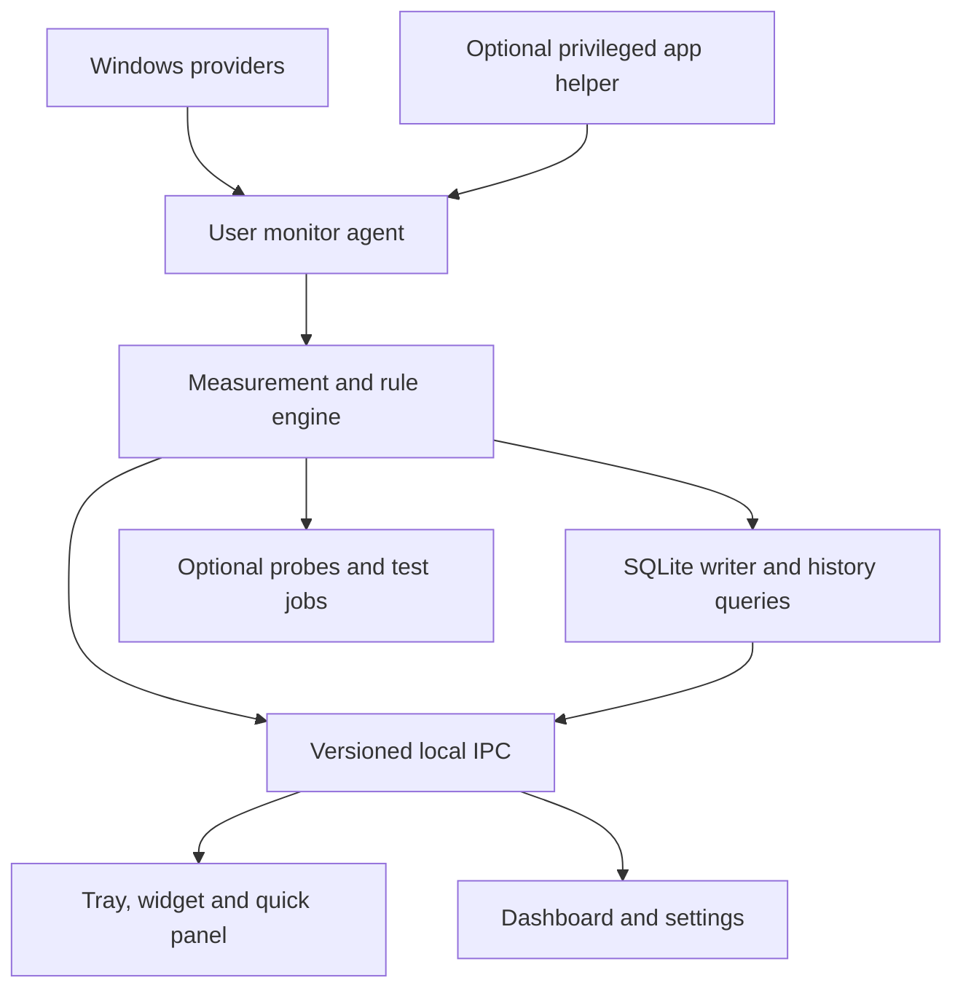

# Premium Speed Meter — Complete V1–V2 Product Requirements Document

**Working name:** SpeedMeter Pro  
**Document revision:** 2.0 — consolidated product plan  
**Prepared:** 8 October 2026 · Asia/Dhaka  
**Product platform:** Windows desktop  
**Primary surfaces:** Taskbar-adjacent meter, floating widget, quick panel, analytics dashboard  
**Planning horizon:** Feasibility prototype → V1.0 → V1.5 → V2.0 → conditional extensions  
**Status:** Proposed specification, ready for product and engineering review; implementation and performance have not been validated  
**Audience:** Product owner, designer, Windows engineer, QA engineer, release/support owner  
**Specification language:** English, with a Bengali reader guide  
**Brand status:** Working name only; final name, identity, price and commercial terms remain product-owner decisions.

---

## Reader guide — কীভাবে এই PRD ব্যবহার করবেন

এই document-এ আমাদের দুইটি plan-এর features একত্র করা হয়েছে। ছোট widget থেকে detailed dashboard পর্যন্ত একই product experience, নির্ভুল measurement, local history, app analytics, quality monitoring এবং advanced tools-এর পূর্ণ পরিকল্পনা আছে।

- **V1.0:** সুন্দর ও নির্ভরযোগ্য speed meter, taskbar/floating display, usage history, quota, basic connection checks, settings, export, installer ও update flow।
- **V1.5:** Per-app monitoring, top consumers, advanced latency/jitter/probe-loss history, downtime analysis এবং ব্যাখ্যাযোগ্য insights। এটি V1 থেকে V2 যাওয়ার মধ্যবর্তী release।
- **V2.0:** Speed test, advanced diagnostics, gaming/OBS modes, richer customization, history backup এবং calibrated optional quality score।
- **Conditional extensions:** Cloud sync, Windows 10 compatibility, ARM64 এবং bandwidth control-এর আলাদা feasibility/business gates আছে। এগুলোকে core release-এর অঘোষিত promise করা যাবে না।

প্রতিটি feature-এর release, expected behaviour, edge cases এবং acceptance criteria দেওয়া আছে। একই traffic দুবার গণনা, idle speed-কে slow internet বলা, sleep-কে outage ধরা, কিংবা unavailable data-কে zero দেখানোর মতো ভুলগুলো স্পষ্টভাবে নিষিদ্ধ।

Development-এর সময় feature matrix, measurement rules এবং acceptance criteria একসঙ্গে ব্যবহার করতে হবে। কোনো কঠিন feature চুপচাপ বাদ দেওয়া যাবে না; পরিবর্তনের কারণ ও revised scope decision log-এ লিখতে হবে। এখানে দেওয়া performance, quality threshold ও timeline হলো **proposed targets**, measured result বা delivery guarantee নয়।

---

## Contents

1. [Product definition and goals](#1-product-definition-and-goals)
2. [Users and jobs to be done](#2-users-and-jobs-to-be-done)
3. [Scope, priorities and platform policy](#3-scope-priorities-and-platform-policy)
4. [Complete feature and release matrix](#4-complete-feature-and-release-matrix)
5. [Information architecture and screen specifications](#5-information-architecture-and-screen-specifications)
6. [Design system and accessibility](#6-design-system-and-accessibility)
7. [Traffic measurement contract](#7-traffic-measurement-contract)
8. [Adapters, network identity and VPN behaviour](#8-adapters-network-identity-and-vpn-behaviour)
9. [Widget, taskbar and tray requirements](#9-widget-taskbar-and-tray-requirements)
10. [Live graphs and session statistics](#10-live-graphs-and-session-statistics)
11. [Usage, history, quota and reporting](#11-usage-history-quota-and-reporting)
12. [Connectivity and downtime](#12-connectivity-and-downtime)
13. [Application bandwidth analytics](#13-application-bandwidth-analytics)
14. [Latency, jitter, loss and quality assessment](#14-latency-jitter-loss-and-quality-assessment)
15. [Alerts and local insights](#15-alerts-and-local-insights)
16. [Network information and diagnostics](#16-network-information-and-diagnostics)
17. [Built-in speed test](#17-built-in-speed-test)
18. [Gaming, streaming and advanced customization](#18-gaming-streaming-and-advanced-customization)
19. [Optional cloud and bandwidth-control extensions](#19-optional-cloud-and-bandwidth-control-extensions)
20. [Onboarding, settings and interaction flows](#20-onboarding-settings-and-interaction-flows)
21. [Technical architecture and implementation decisions](#21-technical-architecture-and-implementation-decisions)
22. [Data model, retention and recovery](#22-data-model-retention-and-recovery)
23. [Performance and reliability targets](#23-performance-and-reliability-targets)
24. [Privacy, security and permissions](#24-privacy-security-and-permissions)
25. [Distribution, licensing, updates and support](#25-distribution-licensing-updates-and-support)
26. [Product metrics and optional analytics](#26-product-metrics-and-optional-analytics)
27. [Acceptance criteria and QA matrix](#27-acceptance-criteria-and-qa-matrix)
28. [Development backlog and delivery plan](#28-development-backlog-and-delivery-plan)
29. [Release gates and definition of done](#29-release-gates-and-definition-of-done)
30. [Risks, dependencies and open decisions](#30-risks-dependencies-and-open-decisions)
31. [Developer handoff and change control](#31-developer-handoff-and-change-control)
32. [Sources and glossary](#32-sources-and-glossary)

---

## 1. Product definition and goals

### 1.1 Product statement

SpeedMeter Pro is a Windows utility that makes current network activity, data consumption and connection behaviour understandable through a compact meter and an on-demand dashboard.

The user should be able to answer:

1. What is uploading and downloading right now?
2. Which applications are responsible, when app monitoring is available?
3. How much data did this PC use during a chosen period?
4. What connection problems were actually observed?
5. Which next diagnostic step could clarify a problem?

The always-visible surface must stay small. Detail appears when requested. The product must distinguish an observation, an estimate and a suspected cause.

### 1.2 Product principles

| Principle | Required product consequence |
|---|---|
| Understandable at a glance | Stable download/upload values, clear units, restrained status indicators |
| Accurate before decorative | Explain measurement scope, missing intervals and partial attribution |
| Depth on demand | Widget → quick panel → five-section dashboard |
| Efficient in the background | Bound resource use; stop hidden animations; batch persistence |
| Local by default | Core functionality works without an account; history stays on the PC |
| User control | Optional probes, notifications, startup, telemetry and cloud features are controllable |
| Reliable recovery | Handle sleep, adapter changes, Explorer restart and storage failures |
| Honest compatibility | Publish tested OS/features; expose fallback behaviour |

### 1.3 Goals and proposed success signals

- First valid live reading within the startup target on reference hardware.
- A new user can configure a preferred meter surface without assistance in under one minute in usability testing.
- Users can find today's usage and identify the largest observed app consumer within two interactions from the quick panel once app monitoring is enabled.
- Core byte accounting passes deterministic fixtures and controlled Windows tests.
- No false outage is created solely by sleep, app shutdown or one blocked ping target.
- All performance and reliability gates in Section 23 pass before a corresponding release claim.
- A readable explanation accompanies every quality classification, insight and unavailable state.

These are proposed evaluation criteria, not existing product results.

### 1.4 Boundaries

The base product observes this PC. It does not automatically measure every device on the home router. It does not increase ISP speed, guarantee game latency, inspect browsing content, decrypt traffic or repair arbitrary network failures.

Router-wide monitoring, remote device administration, a mobile companion, an enterprise fleet console and a VPN service are outside V1–V2 core scope. Per-app blocking/limiting is a separately gated extension. Diagnostic tools must not silently change adapter, firewall or DNS settings.

---

## 2. Users and jobs to be done

| Persona | Job | Primary surface | Success condition |
|---|---|---|---|
| Everyday PC user | See current activity without opening Task Manager | Minimal widget/taskbar meter | Understand download/upload units and activity state |
| Limited-data/hotspot user | Keep usage within a personal budget | Usage & History | Billing dates and quota alerts behave predictably |
| Remote worker/freelancer | Understand interruptions during work | Overview, timeline, diagnostics | Distinguish observed downtime from missing monitoring |
| Gamer | Observe latency variation during play | Optional gaming widget | Small overlay, labelled endpoint, low overhead |
| Creator/streamer | Monitor upload and show selected metrics in OBS | Streaming overlay | No accidental SSID/IP/app-name exposure |
| Power user | Inspect app traffic and export history | Apps, Network Tools | Explainable attribution with searchable details |

### 2.1 Core user stories

- **US-01:** As a user, I can see live download/upload speed without opening the dashboard.
- **US-02:** As a user, I can change units and understand the difference between Mbps and MB/s.
- **US-03:** As a hotspot user, I can set a billing date and receive one notification per quota threshold.
- **US-04:** As a user, I can move between Wi-Fi and Ethernet without a spike or duplicated total.
- **US-05:** As a remote worker, I can see when connectivity was observed unavailable and when monitoring was absent.
- **US-06:** As a user, I can identify the largest measured app consumer without treating unknown traffic as zero.
- **US-07:** As a gamer, I can see latency, variation and probe loss to a selected endpoint.
- **US-08:** As a user, I can run a cancellable speed test after seeing its potential data use.
- **US-09:** As a privacy-conscious user, I can use core monitoring without creating an account.
- **US-10:** As a creator, I can capture a dedicated overlay that omits personal network details.
- **US-11:** As a user, I can export, back up and delete my data through explicit controls.
- **US-12:** As a user with accessibility needs, I can operate every essential flow with a keyboard and screen reader.

---

## 3. Scope, priorities and platform policy

### 3.1 Priority and release vocabulary

- **Must:** Required to pass that release's gate.
- **Should:** Planned; a documented product-owner decision can defer it without misrepresenting the release.
- **Conditional:** Requires the stated technical or commercial decision before it becomes a release commitment.
- **Future:** Outside the V1–V2 core plan; retained explicitly for traceability.

A feature's release version and its pricing tier are separate decisions. “V1.5” means the planned intermediate release, not an unfinished V1.0 requirement.

### 3.2 Release definitions

| Release | Goal | Required outcome |
|---|---|---|
| Prototype / P0 | Resolve high-risk implementation assumptions | Counters, taskbar approach, process attribution, resource profile, compatibility findings |
| V1.0 | Trustworthy everyday meter | Polished display, accurate scoped traffic, local history/quota/export, basic connection checks, lifecycle/recovery |
| V1.5 | Explain activity and connection behaviour | Apps, top consumers, detailed quality history, richer timeline and local insights |
| V2.0 | Add advanced tools and specialist workflows | Speed test, diagnostics, gaming/OBS modes, backup/restore, extended styles and calibrated assessment |
| V2 extensions | Add services or deeper OS control when justified | Independently gated cloud, architecture ports and optional traffic control |

### 3.3 Platform support policy

**Proposed default:** Windows 11 x64 on vendor-supported releases that have passed the product compatibility matrix. At document preparation, Microsoft lists Windows 11 25H2 and device-specific 26H1; supported editions/builds change over time. The published support matrix must be refreshed at every release. Do not hard-code a forever-support promise. [S1]

- Establish a Windows 11 25H2 x64 reference environment at P0; add available supported target builds to QA.
- Treat 26H1/new device hardware as an explicit compatibility lane; do not assume one build's taskbar result transfers to another.
- Windows 10 remains a **legacy compatibility investigation**. Confirm edition, OS servicing and chosen runtime support before offering it. It is not part of the default guaranteed support matrix.
- Windows ARM64 is a conditional V2 port with independent native dependency, performance and installer tests.
- macOS/Linux/mobile clients are future scope.
- No mandatory administrator rights for V1 standard adapter monitoring.
- Optional privileged components must degrade independently; rejecting them must leave supported core functions working.

### 3.4 Commercial assumptions

Ad-free core experience and local-first operation are product requirements. The initial engineering build has no pricing-dependent feature restrictions. Free/Pro packaging, trial length, upgrade entitlement and payment provider are product decisions before commercial launch; a proposal appears in Section 25.

---

## 4. Complete feature and release matrix

This matrix is the scope register. Detailed sections define behaviour; acceptance IDs in Section 27 define completion. “V2 ext.” does not mean included in V2.0 GA.

| ID | Capability | Target | Priority / qualification |
|---|---|---|---|
| F01 | Real-time upload/download throughput | V1.0 | Must |
| F02 | Auto units, bits/bytes, precision, refresh controls | V1.0 | Must; 250 ms advanced mode only V2 after profiling |
| F03 | Compact taskbar-adjacent meter | V1.0 | Must on approved configurations; compatibility fallback |
| F04 | Floating desktop widget | V1.0 | Must |
| F05 | Drag, snap, lock, opacity, topmost, click-through | V1.0 | Must |
| F06 | Live graph: 30 s, 1 min, 5 min, 15 min, 1 h | V1.0 | Must; one-hour data coarsens as needed |
| F07 | Session total, mean and peak | V1.0 | Must; app monitoring-session baseline |
| F08 | Daily, weekly, monthly and custom usage | V1.0 | Must |
| F09 | Billing cycle, daily/monthly quota, alerts | V1.0 | Must |
| F10 | Per-network history and friendly names | V1.0 | Must where identity reliable; unresolved bucket otherwise |
| F11 | Adapter detection and manual selection | V1.0 | Must |
| F12 | Automatic network switching | V1.0 | Must within declared scope |
| F13 | Multiple-interface totals | V1.0 | Must for validated disjoint scopes; ambiguity shown |
| F14 | VPN candidate indicator and scope handling | V1.0 | Must as best-effort observation |
| F15 | Connection status and basic downtime timeline | V1.0 | Must; optional probes, explicit evidence source |
| F16 | Basic current/min/max/mean ping | V1.0 | Must when user enables probes |
| F17 | Rolling jitter and probe-loss metrics/history | V1.5 | Must |
| F18 | Explainable qualitative connection status | V1.5 | Must |
| F19 | Optional numeric quality score | V2.0 | Should; calibration gate, formula/version shown |
| F20 | Per-app live upload/download and totals | V1.5 | Must in supported installed mode |
| F21 | Top bandwidth consumers | V1.5 | Must |
| F22 | App grouping, details, historical trends | V1.5 | Must |
| F23 | Transfer breakdown by direction/application | V1.5 | Must; category tags in V2 |
| F24 | Wi-Fi SSID, signal, channel/band/link info | V1.0 | Must where APIs/permissions expose it |
| F25 | Local IP, gateway, subnet, MAC, DNS, adapter info | V1.0 | Must where exposed |
| F26 | Public IP lookup, copy and optional change history | V1.0 / V1.5 | Lookup V1; change alerts/history V1.5; opt-in requests |
| F27 | Basic reachability and DNS lookup | V1.0 | Must; user-initiated tools |
| F28 | Traceroute, bounded diagnostic suite and DNS flush | V2.0 | Must; flush explicit and privilege-aware |
| F29 | Built-in download/upload speed test | V2.0 | Must; approved provider/backend gate |
| F30 | Test history and comparisons | V2.0 | Must |
| F31 | Quota/connectivity/latency notifications | V1.0 | Must; relevant monitor must be enabled |
| F32 | App high-usage and advanced quality alerts | V1.5 | Must |
| F33 | Transfer-rate threshold alert | V1.5 | Should; explicit transfer watch, never idle = slow |
| F34 | Quiet hours, cooldown, deduplication, alert history | V1.0 | Must |
| F35 | Local baselines and rule-based insights | V1.5 | Must with minimum evidence |
| F36 | CSV/JSON data export | V1.0 | Must for available datasets; expand in later releases |
| F37 | Light/dark/system theme | V1.0 | Must |
| F38 | Font, accent, background, opacity customization | V1.0 | Must with accessibility constraints |
| F39 | Minimal, Compact Graph, Detailed widget layouts | V1.0 | Must |
| F40 | Compact pill, quality card, optional circular display | V2.0 | Should; circular scale semantics must be explicit |
| F41 | Idle dimming/collapse and fullscreen auto-hide | V1.0 | Must |
| F42 | Multi-monitor and DPI handling | V1.0 | Must |
| F43 | Low-resource/battery mode | V1.0 | Must |
| F44 | Startup with optional delay, close-to-tray behaviour | V1.0 | Must; user-controlled |
| F45 | Portable package | V1.0 | Should; published reduced capability matrix |
| F46 | Global hotkeys and complete tray menu | V1.0 | Must; later commands follow feature availability |
| F47 | Local DB, retention, delete controls | V1.0 | Must |
| F48 | Configuration export/import | V1.0 | Must |
| F49 | Consistent history backup/restore | V2.0 | Must |
| F50 | Gaming overlay/profile | V2.0 | Must for windowed/borderless modes; no injection |
| F51 | OBS-friendly capture overlay | V2.0 | Must; personal data hidden |
| F52 | Optional local browser-source feed | V2 ext. | Conditional secure endpoint design |
| F53 | Optional cloud sync and multi-PC summaries | V2 ext. | Conditional separate opt-in service |
| F54 | Signed updates, release notes, rollback/recovery | V1.0 | Must |
| F55 | Ad-free experience and support workflow | V1.0 | Must |
| F56 | Localization-ready UI; Bengali translation | V1.0 / V2.0 | Infrastructure V1; English+Bengali reviewed UI V2 |
| F57 | Optional privacy-preserving product/crash analytics | V1.0 | Should; off by default |
| F58 | Accessible keyboard/screen-reader operation | V1.0 | Must |
| F59 | Per-app limits, block and scheduled control rules | Future / V2 ext. research | Conditional; separate engineering gate |
| F60 | Windows 10 legacy compatibility | V2 ext. | Conditional OS/runtime support decision |
| F61 | Native ARM64 build | V2 ext. | Conditional native dependency and QA results |
| F62 | User-defined application category tags | V2.0 | Should; no content inspection |
| F63 | Save/export diagnostic report | V1.0 / V2.0 | Basic V1; expanded suite V2 |
| F64 | Accessibility-preserving notification/presentation mode | V1.0 | Must; monitoring continues |

---

## 5. Information architecture and screen specifications

### 5.1 Navigation

Exactly five primary destinations:

1. **Overview**
2. **Live Traffic**
3. **Apps**
4. **Usage & History**
5. **Network Tools**

Settings and Help/About are secondary destinations. Quality, speed test, network details and diagnostics are tabs inside Network Tools; they are not extra permanent top-level sections. Alert history lives in Usage & History, with rule configuration in Settings → Alerts.

V1 Apps opens an honest availability explanation if app monitoring is not yet released; it must contain no simulated applications or enabled nonfunctional controls. A shipping product may hide the Apps destination until V1.5 if the product owner chooses; this must be recorded rather than implemented as an unexplained scope change.

### 5.2 Surface behaviour

| Surface | Default content | Primary interaction | Constraints |
|---|---|---|---|
| Taskbar meter | Download and upload, explicit units | Click opens quick panel | No overlap with taskbar controls |
| Floating widget | Chosen one of three layouts | Click opens quick panel; drag when unlocked | Reachable at all DPI settings |
| Quick panel | 60-second graph, today usage, network scope; top 3 apps when available | Open relevant dashboard detail | Anchor to invoking surface; dismiss with Escape |
| Dashboard | Five-section navigation and selected page | Full inspection/configuration | Remember page without reopening stale dialogs |
| Tray menu | Show/hide, dashboard, pause/resume, network, settings, quit | Keyboard-accessible commands | Works even if all overlays hidden |

### 5.3 Overview layout

| Region | Contents | Interaction |
|---|---|---|
| Header | Product, selected measurement scope, connectivity status | Scope selector; show evidence |
| Primary metrics | Download, upload, today usage; optional ping | Relevant detail page |
| Main chart | Live download/upload, default 60 seconds | Open Live Traffic |
| Activity panel | Top observed apps in V1.5; session usage in V1 | Open Apps/session details |
| Quality panel | Endpoint and observation summary | Open Network Tools → Quality |
| Recent events | Last five useful connectivity/quota events | Open timeline |

Do not show public IP, MAC or SSID prominently by default. No fabricated “excellent” badge while probes are disabled.

### 5.4 Other page specifications

- **Live Traffic:** Scope selector, timeframe, two-series graph, current/raw or smoothed designation, average/peak, session bytes, collector state. Resizing must not restart sampling.
- **Apps:** Search and filter toolbar; columns Application, Download, Upload, Selected-period data, Attribution status. Detail drawer shows app identity, current/session/history and relevant alerts. Sort order updates at a bounded rate so rows are selectable.
- **Usage & History:** Usage, Timeline and Alerts tabs. Period, scope, network and optional application filters share a visible context summary. Quota progress and data completeness remain visible.
- **Network Tools:** Quality, Network Details, Diagnostics and Speed Test tabs. V1 exposes available tools only. One active operation panel displays progress, cancel and result provenance.
- **Settings:** General, Appearance, Meter & Widget, Monitoring, Usage & Storage, Alerts, Privacy, Updates, Advanced, About. Use search within settings when there are more than roughly 30 controls.

### 5.5 Core user journeys

1. **First run:** Choose surface → confirm detected scope → choose units → optionally enable connection checks/quota → see live meter.
2. **Unexpected usage:** Click meter → top app → app detail → inspect interval/history → optionally configure an alert.
3. **Suspected connection problem:** Click status → see evidence/window → run a bounded diagnostic → copy a redacted report.
4. **New billing cycle:** Edit cycle rule → preview dates → choose next-cycle or explicit retrospective recalculation → preserve old rule history.
5. **Lost widget:** Tray → Reset widget position → move to current primary monitor.
6. **Permission denied:** Explain affected capability → retain core meter → provide retry/settings link from the relevant feature.

---

## 6. Design system and accessibility

### 6.1 Visual direction

A calm, professional Windows utility with clean typography, precise spacing and restrained surfaces. Decorative emojis, glowing charts, excessive gradients, scattered badges and dense default dashboards are excluded. Functional icons can be used sparingly with accessible names; text labels lead navigation.

### 6.2 Proposed tokens

| Token family | Proposed values / rule |
|---|---|
| Spacing | 4, 8, 12, 16, 20, 24, 32, 40 device-independent pixels |
| Radius | 6 for controls, 10 for panels, 14 for floating surfaces |
| Typeface | Windows system UI family; Segoe UI Variable when available, appropriate fallback |
| Body | 14–16 DIPs; labels 12–14; large values 24–36 |
| Digits | Tabular lining numerals; no width shifts |
| Download | Restrained blue token; validate contrast in each theme |
| Upload | Restrained teal token; distinct legend and line style |
| Status | Text + semantic colour; never colour alone |
| Motion | Short functional transitions, proposed 120–180 ms; reduced-motion mode |
| Dashboard | Initial 1180 × 780 DIPs where available; reflow down to 900 × 620 |
| Small displays | On 1366 × 768 at 150% scaling, use compact navigation/reflow within work area |
| Widget sizes | Minimal about 180 × 44; graph about 220 × 84; detailed about 240 × 132 DIPs; adaptable |

Dimensions are design starting points, not fixed clipping boundaries. Font scaling and Bengali strings must fit without truncating critical values.

### 6.3 Accessibility requirements

- Essential flows fully keyboard-operable with visible focus and logical tab order.
- Screen reader names expose metric label, unit, scope and state. Live regions announce state changes, not every one-second digit update.
- Proposed contrast targets: 4.5:1 for ordinary text, 3:1 for large text and essential graphical controls.
- Respect high contrast, reduced motion, text scaling and system theme changes.
- Charts have accessible textual/table summaries, units, time range and gap explanations.
- Widget click-through can always be disabled from tray or a configured hotkey.
- Custom colours that reduce readability trigger a preview warning and offer accessible defaults.
- Dragging is not the sole way to position the widget: monitor/position controls and reset exist.
- Test keyboard, Narrator, English and Bengali text with actual users or a documented accessibility review.

### 6.4 Empty, loading and error presentation

| Condition | Required display |
|---|---|
| First sample pending | “Measuring…” with no fabricated rate |
| Valid idle interval | 0 B/s, neutral activity indicator |
| Collection paused | “Paused”; old values visually stale |
| No historical coverage | “No data for this period” with coverage explanation |
| Probe disabled | “Connection checks off” |
| Endpoint not responding | “No reply from selected endpoint”; no automatic ISP blame |
| App attribution partial | “Some activity could not be attributed” |
| Permission denied | Affected feature unavailable, precise next action |
| Database unwritable | Live meter continues; persistent-history warning |
| Feature unavailable in portable mode | Capability explanation and supported alternative |

## 7. Traffic measurement contract

**Features:** F01, F02, F07, F11–F14, F47. **Release:** V1.0 Must. **Acceptance:** AC-M01–AC-M08.

### 7.1 Meaning of a displayed number

Every metric must be associated with:

- measurement scope and collection method;
- direction, unit and interval/window;
- collection epoch and sample timestamp;
- validity/completeness state;
- optional network and application identity.

V1 adapter data is labelled **adapter traffic** unless the implemented provider can establish a narrower scope. It can include LAN, multicast and other activity. Microsoft exposes cumulative inbound/outbound octet counters through interface APIs; that does not by itself establish internet-only accounting. [S2][S3]

App-attributed payload/transport observations, interface counters and speed-test goodput are separate measurement domains. Never add them together as if they were independent usage sources. The interface boundary selected for usage/quota accounting is authoritative within its documented scope.

### 7.2 Rate calculation

For two valid readings from the same interface and counter epoch:

```text
elapsed_seconds = monotonic_now - monotonic_previous
received_bytes = current_in_octets - previous_in_octets
sent_bytes = current_out_octets - previous_out_octets
receive_rate_Bps = received_bytes / elapsed_seconds
send_rate_Bps = sent_bytes / elapsed_seconds
rate_Mbps = rate_Bps * 8 / 1_000_000
```

Requirements:

1. Use 64-bit counters and checked arithmetic. Store transferred bytes as integers, not rounded display values.
2. Use a monotonic clock for rate/duration; UTC wall-clock timestamps are for history.
3. Use actual elapsed time, not the configured timer interval.
4. Treat negative deltas, impossible elapsed intervals or identity changes as counter discontinuities; rebaseline and record a gap. Do not use absolute value or silently replace invalid data with zero.
5. Initial sampling after startup/reconnect establishes a baseline. The following valid interval produces the first rate.
6. Do not reject a plausible high rate solely because a virtual adapter reports an inaccurate link speed. Apply provider validity rules and mark suspect samples for diagnosis.
7. Default sample interval: 1 second. V1 options: 0.5, 1, 2 seconds; low-resource mode: 2 seconds. V2 may add 0.25 seconds after profiling.
8. Default display is the current interval rate. Optional smoothing uses a time-aware exponential mean with a proposed 3-second time constant; show the smoothing choice in settings.
9. Usage always accumulates raw validated byte deltas. Display smoothing and unit rounding must never modify accounting.
10. Peak = greatest valid interval-average rate at the recorded sampling interval, not a claimed instantaneous physical maximum. Store that interval with the peak.

### 7.3 Unit contract

| UI unit | Meaning |
|---|---|
| B/s | Bytes per second |
| KB/s, MB/s, GB/s | Decimal byte rates; 1 KB = 1,000 B |
| KiB/s, MiB/s, GiB/s | Optional binary byte rates; 1 KiB = 1,024 B |
| Kbps, Mbps, Gbps | Decimal bits per second; 8 bits = 1 byte |
| GB / GiB usage | Distinct choices; do not mix quota base and display without conversion |

Default: decimal auto byte-rate units, two decimals for MB/s and above, sensible reduced decimals for smaller units. Fixed unit and 0–3 decimal places are available. Unit hysteresis prevents rapid switching around boundaries. Compact abbreviations require an accessible full label/tooltip.

Example fixture: 125,000,000 bytes over 10 seconds equals 12.5 MB/s and 100 Mbps. This is a conversion example, not a prediction of application throughput on a 100 Mbps plan.

### 7.4 Discontinuities and missing coverage

- Sleep, shutdown, explicit pause and collector outage create non-observed spans.
- V1 does not reconstruct rates or usage across those spans. Rebaseline at resume. Display unmeasured coverage rather than pretending a complete billable record.
- A delayed tick within one uninterrupted collection epoch may retain an exact counter delta. If it exceeds three expected intervals, mark its temporal distribution coarse; preserve bytes but avoid inventing short-term peaks.
- An OS counter reset creates a new counter epoch.
- A wall-clock change must not produce negative rates, duplicate byte deltas or silently move a closed billing cycle. Record a clock-change event and start a new wall-clock mapping segment.
- Charts render missing intervals as gaps, not zero lines. Totals show recorded coverage when incomplete.
- Historical totals describe **recorded usage**; they are not a replacement for an ISP bill.

### 7.5 Consistency and test tolerances

- Deterministic counter fixtures: exact integer byte totals; rate conversion error below floating-point/display tolerance.
- Controlled Windows comparison: proposed ≤1% total discrepancy against independently captured counters for the same interface/layer/interval over at least 60 seconds, with synchronized boundaries documented.
- Do not compare a file's payload size directly to interface bytes and expect equality; different layers include different traffic/overhead.
- Widget, quick panel and dashboard subscribe to the same immutable metric snapshot; same snapshot ID must produce the same underlying values.
- Rounded daily display labels need not sum visually to the rounded monthly label; unrounded exported byte totals must reconcile exactly within the same scope and coverage.

---

## 8. Adapters, network identity and VPN behaviour

**Features:** F10–F14, F24–F26. **Release:** V1.0. **Acceptance:** AC-A01–AC-A06.

### 8.1 Adapter inventory

Enumerate physical/logical interfaces, operational state, interface identifier, type and available route information. Treat display name as mutable. Use stable OS identity where available plus an epoch when an adapter is recreated; an interface index alone must not be a permanent key.

Refresh on relevant OS notifications with a low-frequency reconciliation fallback. Never invoke a repeated heavyweight command-line process to obtain one-second rates.

### 8.2 Scope modes

| Mode | Behaviour |
|---|---|
| Auto / primary connection | Follow the selected eligible egress boundary associated with the active default route; label as primary adapter view |
| Selected adapter | Remain on that interface; show disconnected/unavailable rather than silently replacing it |
| Validated aggregate | Sum explicitly selected independent boundaries after duplicate-boundary checks |
| Diagnostic raw interface view | Inspect virtual/LAN interfaces individually; does not silently feed the normal quota |

Auto requirements:

- Determine primary route using route/interface metadata for both IPv4 and IPv6, not whichever adapter has the largest number at one tick.
- Use a short proposed 2-second settling period during route changes and preserve the old/new interval boundary.
- When multiple independent egress routes are active, disclose that the primary view is partial and offer validated aggregation.
- For full-tunnel VPNs, prefer a known physical egress accounting boundary for overall usage; show tunnel measurements separately.
- Where a bridge, virtual switch, VPN or split-routing topology cannot be resolved reliably, ask for a measurement boundary in-app or show a clearly scoped fallback. Never claim automatic de-duplication worked when it is unverified.
- At P0, test Wi-Fi/Ethernet switching, split-tunnel VPN and a virtual-switch configuration before locking the auto-selection algorithm.

### 8.3 No duplicate accounting

A measurement scope has a version, boundary set and membership intervals. Quota views may only consume one canonical accounting stream for a given traffic boundary. Physical and VPN-tunnel counters for the same traffic must not both contribute to one normal total.

Parallel physical interfaces can be aggregated only when their flows/boundaries are independently accounted. Selecting arbitrary bridge members is a raw diagnostic aggregate and must carry a double-counting warning; it is ineligible for a “deduplicated usage” claim.

Switching the visible adapter must not delete historical data or rewrite earlier scope definitions. A quota remains bound to its saved logical scope; unsupported scope changes mark coverage partial.

### 8.4 Network profile identity

- Prefer OS connection-profile identity with locally maintained stable mapping.
- SSID is a display hint, not a globally unique identifier. Repeated SSIDs must not automatically merge unrelated networks.
- MAC randomization, adapter replacement and profile recreation can change identifiers; offer user-driven alias/merge with a preview.
- Allow friendly names: Home, Office, Mobile Hotspot.
- Unresolved traffic belongs to an “Unidentified network” bucket and remains visible.
- Ethernet and Wi-Fi may represent the same user-defined network; merging affects reporting groups, never duplicates or modifies original byte records.

### 8.5 VPN semantics

Show “VPN adapter detected” or “Possible tunnel active,” with available evidence. Do not claim a VPN is secure, encrypted, leak-free or protecting all traffic. Custom/unknown implementations can remain unclassified. VPN alerts are observations of configured adapter/session state, not a security guarantee.

---

## 9. Widget, taskbar and tray requirements

**Features:** F03–F05, F37–F46, F58, F64. **Release:** V1.0. **Acceptance:** AC-W01–AC-W09.

### 9.1 Taskbar strategy

A **taskbar-adjacent/docked companion meter** is the preferred V1 interpretation. Exact taskbar hosting must be proven on each supported configuration; do not assume Windows exposes a stable general-purpose text-widget slot. The notification area is a distinct surface. Existing vendors document a custom implementation for Windows 11 taskbar display. [S4][S5]

Requirements:

- Never cover Start, pinned applications, the notification area, clock, quick settings or notification controls.
- Follow auto-hide behaviour and display work-area changes where supported.
- Support left/centred taskbar layouts and the tested scale factors.
- Recover after Explorer restart; recreate tray presence and recompute geometry.
- If no safe slot can be established, enable the floating minimal widget and show a one-time explanation.
- P0 must decide whether the public feature name is “Taskbar meter” or “Docked meter.” Product copy must match the implementation.
- No mandatory Explorer patch, undocumented shell modification or injection into Explorer for the base product.

### 9.2 Floating widget

Minimal, Compact Graph and Detailed layouts share one settings model and snapshot source. Users can drag, snap, lock, resize through supported scales, set opacity, choose topmost and enable click-through.

- Widget position is stored in monitor-relative DIPs with a monitor identity and fallback anchor.
- On monitor removal, restore the entire widget within the primary work area; do not leave it off-screen.
- Opacity applies without making critical text unreadable by default.
- Enabling click-through shows the recovery shortcut/tray command first; do not trap the user.
- Position lock prevents drag but leaves actions accessible unless click-through is separately enabled.
- Defaults: Minimal layout, opacity 100%, click-through off, position unlocked, topmost on only for the floating widget, fullscreen auto-hide on.
- Hide/close the widget without stopping collection. Pause monitoring is a separate command.
- Proposed idle behaviour: after 30 seconds below the configured activity threshold, dim or collapse. Do not use the threshold to discard small byte counts.

### 9.3 Interactions

- Single click opens the quick panel. Double-click may open the dashboard but cannot be the sole route.
- Right-click opens the context menu. Hover reveals a concise tooltip only; do not require hover for essential controls.
- Escape dismisses the quick panel; opening it must not steal focus repeatedly as data arrives.
- Hotkeys: Open dashboard, Toggle widget, Toggle click-through; V2 adds Gaming profile and Speed test confirmation.
- Hotkey conflicts show a clear error and retain the previous working assignment.

### 9.4 Tray and process lifecycle

Tray commands: Open dashboard; Show/Hide meter; Show/Hide widget; Pause/Resume monitoring; Select scope; Quick tools; Settings; Help; Quit.

“Close dashboard” defaults to keeping monitoring active, with a one-time explanation. “Quit” explicitly terminates the user-session monitor and records a gap boundary. If the optional privileged helper is installed, it must stop this user's active collection session; an installed service may remain idle but must not keep collecting after Quit.

### 9.5 Portable capability matrix

| Capability | Installed V1 | Portable V1 |
|---|---|---|
| Adapter traffic, widget, local history | Required | Required |
| Docked/taskbar companion | Tested OS-dependent support | Same where supported |
| Startup registration | Explicit option | Off by default; explicit optional registration |
| Per-app privileged collection in V1.5 | Optional installed helper | Unavailable unless a separately approved portable method passes QA |
| Updates | Signed guided update | Verify/download package, user replaces safely |
| Storage | Per-user application data directory | Writable adjacent data folder, with permission check |

Portable mode must not silently install services or create machine-wide settings. As a feasibility reference, NetWorx documents a different feature set for its portable app-monitoring mode; our own support matrix must be established by our tests. [S6]

---

## 10. Live graphs and session statistics

**Features:** F06, F07. **Release:** V1.0. **Acceptance:** AC-G01–AC-G04.

- Ranges: 30 seconds, 1 minute, 5 minutes, 15 minutes and 1 hour.
- Two labelled series: download and upload. A combined summary can be selected, but the default preserves direction.
- Y-axis includes zero, rate unit and readable ticks. Automatic scale may be smoothed; optional fixed scale must indicate clipping.
- Hover/focus inspection includes timestamp, rate, scope and quality flags.
- Do not connect a line through gaps. Show event markers without hiding the underlying series.
- Downsample to the chart's pixel budget. Preserve extrema through min/max envelopes; use byte/time-weighted averages for aggregate rates.
- Explain when older live-range data is coarser; do not render invented one-second detail from minute buckets.
- App session begins when monitoring starts or the user explicitly resets session statistics. It is not automatically “since Windows boot.” Windows-boot coverage requires collection for that entire interval.
- Session average uses measured bytes divided by valid measured duration; exclude missing spans and show coverage.
- Reset Session affects only session counters and peaks, not daily/monthly history or quota data.
- Hidden charts stop rendering, while the collector continues. Data updates do not require perpetual 60 FPS animation.

---

## 11. Usage, history, quota and reporting

**Features:** F08–F10, F23, F36, F47–F49, F62. **Release:** V1.0; app breakdown V1.5; tags/backup V2. **Acceptance:** AC-U01–AC-U09.

### 11.1 Aggregation

Support Today, Yesterday, This Week, This Month, Billing Cycle and Custom Range. Show download, upload, total, peak interval rate, coverage and selected scope. Weekly start day is configurable. Store UTC intervals and a configured reporting timezone; default to the Windows timezone at onboarding.

Use half-open intervals `[start, end)` for all queries. A transferred byte must contribute at most once to an accounting total. When a valid sample crosses a reporting boundary, distribute bytes proportionally by elapsed overlap with deterministic integer remainder allocation; retain an estimated-boundary flag. The interval total remains exact, while sub-interval timing is approximate.

Archived daily rollups retain their original UTC boundaries, reporting timezone and calendar-rule revision. If fine-grained data has already expired, changing the reporting timezone cannot recreate exact new daily boundaries. Show the original archived grouping or explicitly label a coarse re-binning estimate; never present reconstructed precision as measured history. An arbitrary custom range that clips an archived bucket must expose the same limitation.

Direction share uses `direction_bytes / (download_bytes + upload_bytes)`. At zero total display “No recorded traffic,” not NaN or an invented 50/50 split.

### 11.2 Billing rules

- Daily quota and monthly cycle quota support download-only, upload-only or combined bytes.
- Monthly start day: 1–31, local midnight in the rule's saved timezone. If the month lacks that day, clamp to the last day of that month; the next boundary is computed independently from the original requested day.
- Example: day 31 can produce 31 January → 28 February → 31 March in a non-leap year. Show exact dates before saving.
- Date/time changes do not erase records. Changing a cycle rule defaults to the next cycle; applying it to the current period requires an explicit preview.
- Keep rule revisions and completed cycle summaries so historical reports remain interpretable.
- Quota display resets by opening a new accounting period, not by deleting history.
- Default thresholds: 80%, 90%, 100%; configurable. A threshold notification occurs once per quota-rule revision and cycle.
- If imported data or a scope correction changes the total, recompute the ledger without re-sending old notifications unless the user explicitly requests a new alert evaluation.
- Optional opening balance can be entered when monitoring starts mid-cycle. Display “Recorded usage + opening balance,” store them separately and do not fabricate historical samples.
- Missing history means the quota may undercount. Warn on incomplete coverage and retain the user's opening balance.

### 11.3 Per-network and app breakdown

Network reports use saved profile mappings and time-bound scope membership. App reports use the attribution domain, with unknown/unattributed activity visible. Label transport/application observations clearly when they cannot reconcile directly with adapter accounting.

V2 category tags are manually assigned or based on disclosed local app metadata rules. They must not infer the subject/content of browsing from traffic inspection.

### 11.4 Export contract

CSV and JSON are required for each released dataset: usage, events, alert history, app observations, quality metrics and speed tests as those modules ship.

Exports contain:

- schema version, app version, generation timestamp;
- UTC timestamps and selected reporting timezone;
- inclusive/exclusive range semantics;
- scope identifier, source/method, units and completeness;
- integer byte totals; unrounded rates where appropriate;
- missing-data/attribution flags and optional opening-balance distinction.

CSV uses UTF-8, quoted fields and spreadsheet-formula injection protection for user-controlled names. JSON has typed numeric values, explicit nulls and a documented schema version. Export must support cancellation, preserve the filtered scope, and write to a temporary destination before atomic completion.

No partial export should be presented as complete. Disk-full or permission errors must keep the original destination unchanged. Privacy-sensitive fields are excluded by default; the export preview lists optional inclusions.

### 11.5 Configuration and history backup

V1 exports/imports versioned settings, layouts, quota rules and alert definitions. Validate schema, types and ranges before applying; preview changes; never import credentials or silently enable cloud/probes.

V2 history backup creates a consistent database snapshot using a supported backup mechanism. Restore stops writers, verifies integrity/schema, makes a pre-restore backup and atomically switches on success. Failed restore preserves the active database. A raw copy of only an open WAL-mode database file is not a valid backup strategy. [S10]

## 12. Connectivity and downtime

**Features:** F15, F16, F31, F34. **Release:** V1.0. **Acceptance:** AC-C01–AC-C07.

### 12.1 Three independent state axes

Do not combine collector health, connectivity and quality into a single confusing enum.

| Axis | States |
|---|---|
| Collector | Starting, Running, Paused, Suspended, Degraded, Failed |
| Connectivity | Unknown, Checking, Reachable, Limited/Checks failing, No local connection, Sign-in suspected |
| Quality | Not measured, Warming up, Stable within thresholds, Elevated latency, Variable latency, Probe loss |

“High latency” can coexist with Reachable. “Paused” says nothing about the actual internet connection. “VPN detected” is separate metadata.

### 12.2 Evidence and probes

- Use OS link/profile events as passive evidence, labelled accordingly.
- Remote checks are optional and clearly disclosed during onboarding or when enabling the feature.
- The endpoint registry must specify protocol, expected response, timeout, minimum interval, ownership/usage policy and a user-visible label.
- For internet reachability, use two independent approved endpoints/protocol paths when practical; at least one check is HTTPS-based. One failed ICMP endpoint must not establish internet downtime.
- Proposed default active reachability interval: 30 seconds, request timeout 3 seconds, at most one outstanding request per endpoint.
- Enter Checks failing after three consecutive rounds in which all configured viable reachability endpoints fail. Record the first failed round as the possible start and the confirmation time separately.
- Return to Reachable after two successful rounds. Record first observed success and confirmation separately.
- A local link-loss event may immediately show No local connection; recording and notification include a proposed 5-second debounce to avoid transient switching spam.
- Remote checks must respect proxies where applicable. Unsupported authentication/proxy environments show incomplete checks, not certain global internet failure.
- Captive-portal evidence may show “Sign-in may be required.” Do not scrape credentials, accept invalid TLS or intercept the sign-in flow.
- The UI displays the last check time. Old results become stale rather than remaining green indefinitely.

Endpoint defaults are a release dependency. Use endpoints with an approved intended usage; do not assume unrestricted automated use of an unrelated public service. On metered networks, background checks are off by default until the user enables them.

### 12.3 Observation interval and uncertainty

An outage record includes scope, evidence type, first failed observation, confirmation time, first successful observation, finalization time and timing resolution. Durations are estimates bounded by the check cadence; display “about” where appropriate.

If collection pauses, sleeps or stops during an interruption, close the observed segment at the last observation and mark its end uncertain. The unobserved interval is a separate gap. Never extend downtime across sleep or infer an exact restoration time on resume.

### 12.4 Availability calculation

```text
observed_availability = reachable_observed_duration /
                       (reachable_observed_duration + unavailable_observed_duration)
```

Exclude Unknown, Checking warm-up, Paused, Suspended and missing intervals. Also show measured coverage of the selected time range. If remote checks are disabled, report **local link availability** only; do not label it internet uptime.

### 12.5 Timeline events

Record collector start/stop/pause/resume, adapter selection change, network profile change, local link transitions, check failures/recovery, user-enabled public-IP changes, VPN candidates, quota thresholds and completed tests. Event details include source and certainty, not a fabricated root cause.

---

## 13. Application bandwidth analytics

**Features:** F20–F23, F32, F62. **Release:** V1.5 Must; categories V2 Should. **Acceptance:** AC-P01–AC-P08.

### 13.1 Product requirements

- Display current download/upload, session bytes, selected-period bytes and observed application identity.
- Search display/executable name; sort by either direction or total bytes.
- Group browser child processes when a reliable local app identity exists; offer process-level expansion.
- Preserve historical totals after process exit or app update.
- Show current top consumers and period top consumers separately.
- An app drawer includes identity, attribution status, rate/usage chart, peak observation, history and an alert shortcut.
- Limit row reordering to a proposed once every 2 seconds and pause reordering while interacting with a row.
- Do not infer “syncing,” “streaming” or “malicious” merely from throughput. Default activity state is Active/Idle/Exited/Partial.

### 13.2 Attribution contract

The P0 spike must evaluate ETW TCP/UDP IPv4/IPv6 events, process lifecycle and relevant event loss. ETW is a candidate, not a promise that every Windows traffic path yields complete app accounting. Event-specific process identifiers require care; network events are not always attributable by blindly reading the event header PID. [S7][S8]

Requirements:

1. Process identity includes PID plus creation time/epoch; handle PID reuse.
2. Application identity is separate from process identity. Use a versioned local mapping based on supported package identity or normalized executable identity.
3. Protected/system/shared-host activity can remain unresolved. Do not falsely split shared service-host traffic among individual services without a supported source.
4. Detect dropped events, buffer loss, permission loss and collector restart. Mark affected intervals incomplete.
5. TCP, UDP, IPv4, IPv6, QUIC-over-UDP, short-lived processes and high-rate traffic are required test cases.
6. VPN encapsulation, proxies, loopback and retransmissions must have documented attribution behaviour; outer VPN process traffic must not be merged into a double-counted application total.
7. App byte totals are not forced to equal adapter counters. Explain different layers, overhead and incomplete observation.
8. Maintain an Unknown/Unattributed bucket only for bytes actually observed by that provider without a reliable app mapping. Do not invent this bucket by subtracting unrelated measurement layers.
9. “Internet/LAN” classification requires supported flow/route evidence. Private IP alone does not prove local traffic, particularly through corporate VPNs. Otherwise use Local, Non-local, Tunnel/Private remote or Unknown as evidence allows.
10. Keep flow endpoints ephemeral unless the user initiates a bounded diagnostics session; a long-term connection/browsing log is outside the default product.

### 13.3 Installed helper and permissions

Use an optional signed helper/service only if required by the validated provider. Installation and permission are requested when the user enables App Monitoring. The normal UI remains unelevated.

If the provider is unavailable:

- core meter and adapter usage continue;
- Apps explains the reason and available recovery action;
- historical app data remains readable;
- current app values show unavailable, not zero;
- portable mode advertises only its verified capabilities.

On shared PCs, app identity/history must be isolated per authorized Windows user. Device-level adapter counters may include other sessions' activity and must be labelled device/interface scope. Do not expose other users' app names/paths through IPC or exports.

### 13.4 Attribution quality gate

For supported isolated test scenarios, proposed goal: ≥95% of provider-observed bytes map to the expected test application with no cross-process misattribution. This is a provider-domain criterion; it is not a guarantee of 95% of every adapter's bytes in all VPN/system scenarios. Expected limitations require visible labels and published compatibility notes.

---

## 14. Latency, jitter, loss and quality assessment

**Features:** F16–F19. **Release:** Basic ping V1; advanced metrics V1.5; optional score V2. **Acceptance:** AC-Q01–AC-Q07.

### 14.1 Ping measurement

- The selected endpoint and protocol remain visible.
- V1 exposes current, min, max and arithmetic mean of successful RTTs over a selected window; V1.5 adds median and p95.
- For exact in-memory windows, use the conventional median (mean of two middle values for an even count) and nearest-rank p95 at sorted index `ceil(0.95 * n)`. Persist the method version; any long-range approximate percentile must identify its aggregation method and error properties.
- Default interval: 2 seconds for the active quality session; options 1, 2, 5 and 10 seconds. Low-resource profile uses 5 seconds.
- Timeout, cancelled, local-send failure and pending outcomes are distinct.
- RTT is measured with a monotonic clock. DNS resolution time is separate from ICMP RTT.
- Endpoint failure is not automatically user internet failure. Show relevant connectivity evidence alongside it.
- Ping monitoring is optional, including from the widget; disabling it stops its network requests.

### 14.2 Loss definition

Label the metric **Probe loss** or **ICMP probe loss** with a tooltip. It describes those probes to that endpoint, not the measured loss of every game or application.

```text
completed_attempts = successful_replies + timed_out_attempts
probe_loss_percent = 100 * timed_out_attempts / completed_attempts
```

Exclude not-yet-completed attempts and local failures to transmit. Display counts, protocol, endpoint and window. An empty denominator is unavailable. Cancelled attempts are not losses. Count precision must match the sample size; 1 loss in 30 attempts is approximately 3.3%, not a precise sub-percent assessment.

### 14.3 Jitter definition

Use a named simple metric: **mean absolute successive RTT difference**.

```text
jitter_ms = mean(abs(RTT[i] - RTT[i-1]))
```

Include only adjacent successful scheduled probes within the same endpoint/session; do not bridge a timeout, target change or collection gap. Require at least five valid adjacent pairs; otherwise show Warming up. This is RTT variation, not a claim of one-way RTP jitter.

### 14.4 Windows and qualitative assessment

Default quality window: 60 seconds; allow 5 minutes and 15 minutes. Require at least 20 completed attempts for loss-based classification and 10 successful RTTs for latency percentiles. Display warming/incomplete status until the relevant evidence is available.

Proposed initial thresholds, subject to QA and endpoint context:

| Observation | Proposed starting trigger | Recovery |
|---|---|---|
| Elevated latency | p95 RTT >150 ms for 30 valid seconds | Below 120 ms for 30 valid seconds |
| Variable latency | Jitter >30 ms with sufficient pairs | Below 20 ms for 30 valid seconds |
| Probe loss | Loss ≥5% with at least 20 completed attempts | Below 2% for a complete valid window |
| Stable within thresholds | None of the enabled threshold conditions | Re-evaluate each window |

These are product defaults, not universal networking standards. A distant endpoint may naturally have high RTT. The user can choose targets/thresholds; do not claim a connection is suitable for a particular game based on an unrelated endpoint.

### 14.5 Optional V2 numeric score

Do not ship a decorative score. The optional score is disabled until usability/calibration tests validate its wording. It assesses recent observations to a selected endpoint, not overall ISP quality.

Proposed transparent model, version `quality-v1`:

```text
L = clamp((p95_RTT_ms - 30) / 170, 0, 1)
J = clamp((jitter_ms - 5) / 35, 0, 1)
P = clamp(probe_loss_percent / 5, 0, 1)
score = round(100 * (1 - 0.40*L - 0.25*J - 0.35*P))
```

Use a 5-minute window with at least 60 completed attempts, 30 successful RTTs and five valid adjacent pairs. When those requirements fail, display insufficient data; when reachability fails, show the connectivity state separately, not a fabricated score. The UI shows each penalty, thresholds, endpoint, method version and sample count.

Any later formula change starts a new method version. Historical scores retain the original method; comparisons across versions must be explicitly marked or recomputed from adequate source data.

---

## 15. Alerts and local insights

**Features:** F31–F35, F57, F64. **Release:** V1/V1.5. **Acceptance:** AC-N01–AC-N07.

### 15.1 Common alert engine

An alert rule contains type, scope/network/app filter, threshold, observation window, minimum samples, persistence duration, recovery threshold, cooldown, channels, quiet hours and enabled state.

- Evaluate in the background independently from dashboard visibility.
- Require valid observations. Stale/unavailable data cannot satisfy a threshold.
- One active incident per rule/scope key, with trigger and recovery events.
- Proposed default cooldown: 10 minutes; configurable per rule.
- Persist deduplication state so app restart does not replay the same quota/incident alert.
- Quiet hours, Windows notification settings and presentation/gaming profiles suppress popups while retaining alert history.
- No sound by default. Optional sounds require explicit selection.
- A notification explains the metric, scope/window and action to view details.

### 15.2 Alert catalogue

The V1 high-ping rule uses successful-reply mean RTT over a 30-second window, with at least 10 replies: proposed trigger above 150 ms for 30 valid seconds, recovery below 120 ms for 30 valid seconds. V1.5 can add the p95-based quality rule from Section 14 as a distinct rule type. Never silently change an existing user's mean-based rule into a percentile-based rule during upgrade.

| Alert | Release | Rule and safeguards |
|---|---|---|
| Quota threshold | V1 | Once per threshold/cycle/rule revision; precise usage scope |
| Local disconnect/recovery | V1 | Debounce link changes; include observation duration |
| Reachability check failure/recovery | V1 | Requires configured multi-check evidence; labelled as observed |
| High ping | V1 | Valid selected endpoint and sustained threshold |
| Jitter / probe loss | V1.5 | Sample minimums and hysteresis |
| App high usage | V1.5 | User-set bytes/window or sustained rate; no maliciousness claim |
| Public IP changed | V1.5 | Opt-in provider request, scope and address-family aware |
| VPN candidate disappeared | V1.5 | User-selected observation; no protection guarantee |
| Transfer rate below threshold | V1.5 Should | Explicit watch session with scope, timeout and expected-active transfer |

### 15.3 Transfer watch

A transfer watch is started by the user for a chosen scope/app. It has a warm-up period, minimum sustained activity, threshold duration and maximum watch lifetime. Before sustained transfer is observed, it remains Waiting. When traffic stops, say “Observed transfer activity fell below your threshold.” Do not assert that the connection slowed or that a download failed; the application may have finished normally.

At watch expiry or user cancellation, stop evaluation. Ordinary idle background usage never triggers this alert.

### 15.4 Baselines and insight requirements

V1.5 computes local deterministic baselines. No external AI service is required.

- A comparative baseline requires at least 7 separate days, 30 valid comparable windows and ≥80% coverage within the compared windows.
- Match network identity, endpoint/protocol, measurement method and comparable time-of-day where relevant.
- Exclude speed-test intervals, insufficient data and known collector degradation from quality baselines; keep their bytes in usage.
- Use a documented robust statistic such as the median of comparable window values; do not compare a single peak against an unrelated daily mean.
- Suppress percent-change claims when the baseline is near zero; use an absolute difference or no insight.
- Store baseline version, sample count and evidence range.
- A dismissed insight stays dismissed for its evidence period. Limit the Overview to at most three useful items.

Allowed examples: “Chrome used 4.8 GB of observed app traffic today”; “RTT to your selected endpoint is above your 7-day comparable median”; “80% of your configured recorded-data budget has been used.”

Do not claim the ISP, malware or a specific app caused an outage without sufficient evidence. Suspicions must be labelled and accompanied by the diagnostic evidence that could test them.

## 16. Network information and diagnostics

**Features:** F24–F28, F63. **Release:** Basic details/tools V1; advanced diagnostics V2. **Acceptance:** AC-D01–AC-D07.

### 16.1 Network details

Show available adapter name/type, operational state, IPv4/IPv6 addresses, prefix/subnet, gateway, DNS server addresses, DHCP state, local profile, MAC and receive/transmit link speed. Copy actions are field-specific and keyboard-accessible.

Wi-Fi details may include SSID, signal strength, band/channel and authentication metadata where supported. Link speed is labelled **link speed**, not internet plan speed. Fields missing from the selected API/driver show unavailable.

Some Wi-Fi APIs are subject to Windows location consent. Use an appropriate minimal-data API for the requested field and request additional access only from a relevant user action. Permission refusal must leave the rest of the product functional. [S9]

### 16.2 Public IP

- A lookup contacts an external service that necessarily sees the connection's public source IP; disclose this at enablement.
- Manual lookup is available in V1. Automatic change monitoring is opt-in V1.5, proposed no more than once per 15 minutes plus a debounced route-change refresh.
- Cache with time and selected scope; distinguish IPv4 and IPv6 where the provider supports both.
- Under VPN/split routing, explain that the returned address is the egress used to reach that provider; it is not a full VPN leak test.
- Rate limits, offline errors and provider failure must not block the meter.
- Public IP history is off by default and has separately configurable short retention.

### 16.3 Tool catalogue

| Tool | Release | Output and limits |
|---|---|---|
| Bounded ping | V1 | Target, protocol, count, successes/timeouts, RTT; default 10 attempts |
| DNS lookup | V1 | Requested name/type, resolver if known, answers, measured lookup duration |
| Reachability check | V1 | Local link, approved endpoint checks, evidence and uncertainty |
| Diagnostic report | V1 | Redacted current state plus user-selected recent history |
| Traceroute | V2 | Bounded hop/time limit; unresolved hops remain unresolved |
| Expanded diagnostics | V2 | Separate gateway, DNS and remote checks with a cautious summary |
| Flush DNS cache | V2 | Explicit system-changing command with explanation and privilege handling |

Default traceroute limits: 30 hops, up to 2 attempts per hop, 1-second timeout and an overall 60-second deadline. Limits are product defaults, configurable within safe bounds. A missing intermediate-hop response does not prove failure at that hop.

### 16.4 Execution requirements

- Prefer Windows/native APIs; if a command-line tool is used, pass structured arguments without shell interpolation.
- Validate target hostname/IP, record type and bounds. Support IPv6 correctly.
- At most one expanded diagnostic suite runs at a time. Individual jobs are cancellable and bounded.
- DNS flush is never part of an automatic “fix everything” button. Explain the intended cache change, perform it only after the user's action, and show success/failure truthfully.
- Copy/export previews default to redacting public/local IPs, SSID, MAC, executable paths and user names. Offer an explicit inclusion choice when a support recipient needs more detail.
- Diagnostics never claim a conclusive ISP/app/root-cause diagnosis from an inconclusive test.

---

## 17. Built-in speed test

**Features:** F29, F30. **Release:** V2.0 Must, dependent on provider gate. **Acceptance:** AC-T01–AC-T06.

### 17.1 Provider/backend gate

Before implementation is committed, choose an authorized SDK/service or an operated test backend. Verify intended-use permission, commercial terms, geographic server coverage, rate limits, privacy, cost, maintenance ownership and offline failure behaviour. Do not scrape another product's private endpoint or silently reuse an unofficial integration.

If no acceptable provider is available, V2.0 cannot claim a built-in speed-test feature is complete. The product owner must explicitly revise scope and public copy; a fake result or unrelated web link is not equivalent acceptance.

### 17.2 User flow

1. Open Speed Test.
2. See active network, server/provider, estimated data use/range and maximum configured budget.
3. Start or cancel before transfer. Metered networks require an explicit per-test start unless a separately configured schedule has metered permission.
4. Progress through Preparing, Latency, Download, Upload and Complete/Partial/Cancelled/Failed.
5. Display provider/server, time, methodology version, download/upload rate, latency, measured bytes, duration and completeness.
6. Save history and allow comparison with results from comparable contexts.

### 17.3 Measurement and operational rules

- Only one speed test per device/session owner; reject duplicate starts.
- Use monotonic duration and provider-approved sampling. Label application-level test throughput appropriately.
- Proposed initial defaults: 30-second overall limit and a 250 MiB total transfer cap, adjustable within provider limits. Very fast links may hit the cap; show “capped/partial” when the methodology cannot produce a valid full result.
- Cancellation stops scheduling new transfers immediately and tears down active operations within a target 2 seconds.
- Record completed phase values for a cancelled test as partial; never fill missing phases with zero.
- Speed-test traffic remains included in data/quota usage. Flag its interval so quality baselines and unusual-usage insights can exclude the artificial load.
- Background download/upload can affect the result. Display concurrent activity if available without claiming precise subtraction of unrelated traffic.
- An automatic schedule is an optional V2 Should feature: off by default, respects metered networks, quota budget, quiet hours, battery and active gaming/presentation state.
- Connection or server changes during a test invalidate cross-phase comparability; mark partial or restart only with user intent.

### 17.4 History

Store timestamp, network/scope, server/provider, protocol/method version, measured rates, latency, actual bytes when exposed, cap, duration and result status. Do not compare differently capped/incomplete tests as equivalent complete tests. Export history using the common export contract.

---

## 18. Gaming, streaming and advanced customization

**Features:** F38–F40, F50–F52, F56, F62. **Release:** V2.0, with optional browser feed gated separately. **Acceptance:** AC-X01–AC-X04.

### 18.1 Gaming profile

- A small overlay presents selected endpoint RTT, jitter/probe loss and download/upload.
- The endpoint name is accessible; do not label a generic endpoint as the current game's server.
- Use a normal transparent/topmost window for supported windowed/borderless games.
- Exclusive-fullscreen and anti-cheat compatibility must be tested and documented; no promise of universal visibility.
- No DLL injection, game-memory access, anti-cheat bypass or kernel overlay component.
- Gaming profile can suppress ordinary notifications and reduce background rendering. Important storage/collector failures remain in history with an accessible status indicator.
- Profiles can be selected manually or through user-configured app associations; do not scan game content.

### 18.2 OBS/streaming overlay

Provide a separate, stable capture window with configurable foreground/background/opacity and compact layout. Test OBS window capture and documented transparency handling on the supported configuration.

Default output includes only numeric selected metrics and neutral labels. It excludes SSID, IP, MAC, process names, diagnostic messages and personal notifications. Preview the actual exported surface in-app. The overlay must not expose a private dashboard behind it during resize or errors.

A local browser-source feed is a separate conditional extension: bind to loopback, restrict routes/origins as appropriate, use a high-entropy access token, provide read-only metric output, expose no file/command endpoints, and rotate/revoke access. It must never bind to all network interfaces by default.

### 18.3 Additional widget styles

Compact pill, Quality Card and optional circular display reuse the same measurement model. A circular meter needs a declared scale: user-configured reference capacity or measured peak. It must not invent a utilization percentage from an unknown ISP plan. When no scale exists, show numbers rather than a misleading ring.

### 18.4 Saved profiles and localization

Save profile settings for layout, monitor anchor, units, opacity, selected metrics and notification behaviour. Switching profiles does not erase usage history or silently enable external services.

V1 UI strings are resource-based. V2 includes reviewed English and Bengali UI/help strings, robust font fallback, readable long labels and proper date/number formatting. Live numeric telemetry can retain Latin digits by default, with a separate locale-digit option after readability tests.

---

## 19. Optional cloud and bandwidth-control extensions

**Features:** F53, F59–F61. **Status:** Conditional; not part of V2.0 core completion. **Acceptance if enabled:** AC-X05–AC-X06 plus extension-specific review.

### 19.1 Cloud sync product boundary

The local app works without an account. Cloud sync is an optional service for selected aggregated history/settings across the user's PCs. It does not provide remote packet inspection or remote machine control.

Minimum requirements if approved:

- Explicit sign-in and per-device opt-in; local collection settings remain independent.
- Choose datasets: summary usage, quality summaries, selected settings. Raw flow data, SSIDs, IPs and app names are excluded by default.
- Stable pseudonymous device/record identifiers, idempotent uploads and versioned schemas.
- Preserve local data when the service is unavailable or the subscription ends.
- Show last successful sync and queued state; bounded exponential retry and metered/battery controls.
- Server authorization must isolate accounts and devices. Encrypt in transit and at rest with documented key management; do not claim end-to-end encryption unless implemented and reviewed.
- Local/cloud deletion, account deletion, revocation and device removal need explicit semantics.
- Deletion tombstones prevent erased history from being restored by another device's old queue.
- Define retention, hosting region, backup deletion delay, incident owner and monthly operating budget before launch.

Conflict rules:

| Data | Resolution |
|---|---|
| Immutable usage interval | Unique device + scope + source + interval key; replay is idempotent |
| Settings | Versioned edit; surface conflicts where user intent is ambiguous |
| Network aliases | Device-local by default; user chooses cross-device grouping |
| Deletion | Tombstone wins over stale uploads; explicit restore is a new operation |
| Clock mismatch | Preserve device timestamps and server ingestion time; flag uncertainty |

Never sum the same record received twice. Different PCs' usage may legitimately overlap in time; identify device scope clearly.

### 19.2 Bandwidth-control research

Per-app rate limiting, blocking, priorities, quotas that enforce rules and schedules substantially expand responsibility. Windows Filtering Platform is a possible foundation for filtering/control; the appropriate implementation may require a privileged service/driver and dedicated expertise. It is not interchangeable with a lightweight adapter meter. [S12]

Before adding this extension:

- Prototype TCP/UDP/IPv6, VPN and shared-service behaviour.
- Validate installation, signing, OS compatibility and uninstall recovery.
- Define rule precedence, temporary override, recovery after service failure and a safe reset path.
- Prevent a rule from silently blocking update/support/recovery access without a visible user decision.
- No automatic traffic restriction in the base monitoring product.
- Schedules and quota-triggered rules require their own user stories, acceptance cases and support plan.

### 19.3 Platform ports

Windows 10 and ARM64 require a supported runtime/native dependency combination, signed installation/update path and full measurement/display tests. No platform port is complete solely because the UI launches.

---

## 20. Onboarding, settings and interaction flows

### 20.1 First-run flow

Target: first useful reading with minimal setup. Optional choices can be skipped and changed later.

1. Briefly describe what the meter observes and that live traffic differs from a speed test.
2. Choose Docked meter, Floating widget or Both; recommended initial choice is the best validated surface for that machine. Do not open two overlays without the user's selection.
3. Show detected primary scope and Auto/Manual choice.
4. Choose byte or bit units; default decimal byte units.
5. Offer optional connection checks with endpoint/request disclosure. Default off until chosen.
6. Offer optional data budget/billing date.
7. Offer startup registration, off until chosen.
8. Finish with live data and a short instruction for opening details and recovering a hidden widget.

Request no account, app-monitoring elevation or Wi-Fi/location permission before the associated user action. Optional analytics and crash reports are off by default.

### 20.2 Default settings register

| Setting | Proposed default | Notes |
|---|---|---|
| Sample interval | 1 s | Low-resource 2 s; values use actual elapsed time |
| Rate display | Current interval, auto decimal bytes | Optional smoothing clearly selected |
| Direction order | Download then upload | User can reverse |
| Widget style | Minimal | Three V1 layouts |
| Always on top | On for floating widget | Fullscreen auto-hide on |
| Click-through | Off | Recovery route always available |
| Opacity | 100% | Accessible preview |
| Theme | Follow system | Light/dark override |
| Scope | Auto primary | Scope label always available |
| Remote quality checks | Off until enabled | Metered default off |
| Public IP auto-refresh | Off | Manual lookup available |
| Quota | Disabled until configured | Suggested 80/90/100% thresholds |
| Sound notifications | Off | Windows notification controls respected |
| Quiet hours | Disabled until configured | Presentation mode separate |
| Startup | Off until selected | Optional 0/5/15/30-second delay |
| Close dashboard | Continue in tray | Explain once; Quit available |
| Raw live ring | Up to 1 h in bounded memory | No raw long-term persistence by default |
| History retention | Section 22 defaults | Configurable with coverage preview |
| Telemetry/crash reporting | Off | Independent controls |
| Update check | Daily when enabled | Disclose external request; manual always available |
| Metered update download | Off | User can override |
| Language | OS match if supported; English fallback | Bengali added in V2 |

### 20.3 Validation and interaction details

- Numeric settings have units, reasonable bounds and inline validation.
- A setting preview applies reversible appearance changes immediately; Reset restores documented defaults.
- Reset settings and Delete history are separate actions with different confirmation copy.
- Deleting selected/all history stops conflicting writes, clears related aggregates/indices and marks affected quota coverage incomplete.
- Pause offers Resume and optional duration. History records the gap. Hiding the interface does not pause.
- Permission changes are observed where possible; provide retry without requiring a full reinstall.
- Only user-enabled features create network requests. A disconnected or unlicensed cloud feature must not repeatedly open sign-in dialogs.
- Error messages include a useful action and expandable technical details with a support reference code.

## 21. Technical architecture and implementation decisions

### 21.1 Recommended baseline

**Proposed implementation:** C# with .NET 10 LTS, WPF for the desktop UI, native Windows interop for measurement/window integration, SQLite for local persistence and a testable application/domain layer. At the time of this document .NET 10 is an active LTS release; pin an actively supported patch at implementation/release time and verify its supported OS matrix. WPF provides a Windows desktop UI framework; its choice here is an engineering recommendation, not a measured performance result. [S11][S13][S14]

A WinUI 3 alternative is acceptable only through an architecture decision documenting taskbar/widget feasibility, deployment and resource effects. Do not change the stack casually halfway through the project. This PRD does not require a browser runtime, Electron, remote backend or web account for the local product.

### 21.2 Components and boundaries



| Component | Responsibilities | Must not do |
|---|---|---|
| Windows provider adapters | Counters, route/profile events, capability discovery | Fabricate unavailable data |
| User monitor agent | Sampling lifecycle, canonical scope, snapshots | Depend on an open dashboard |
| Optional privileged helper | Approved app-attribution source, bounded responses | Execute arbitrary client commands or expose other users' app data |
| Measurement/domain engine | Rates, coverage, quota, quality, alerts, baselines | Depend on UI controls or provider-specific display names |
| Storage owner | Single serialized writer, transactions, migrations, retention | Allow competing unsynchronized writes |
| Local IPC layer | Versioned typed requests/events, user/session ACLs | Trust arbitrary local callers |
| Desktop UI | Present state and route user actions | Run blocking sampling/DB work on UI thread |
| Job engine | Cancellable probes/diagnostics/tests | Unbounded background requests |
| Updater | Verify and stage signed packages | Run an unverified payload |

P0 can implement agent/domain and UI in one process if resource and lifecycle tests justify it. Preserve component interfaces so a separate agent/helper can be introduced without rewriting accounting. Performance budgets always include all product processes, regardless of deployment choice.

### 21.3 Provider interfaces

Define versioned interfaces for adapter snapshots, network/profile changes, process observations, probe outcomes, speed-test phases, history queries and capability status.

Every provider returns typed availability and quality metadata. Unsupported, denied, partial and temporarily failed are different results. No production provider returns mock success data to hide an unfinished implementation.

A live snapshot includes snapshot ID, UTC time, monotonic epoch/offset, scope revision, raw bytes, interval duration, display rates, coverage flags and collector status. Consumers may skip superseded display snapshots, but accounting deltas must never be dropped silently.

### 21.4 Concurrency and backpressure

- Sampling, aggregation, DB writes and UI rendering have separate bounded queues/jobs.
- A single accounting pipeline commits each delta once using a unique interval/event key.
- When display consumers are slow, replace their pending snapshot with the newest one.
- When accounting buffers fill, persist or mark a coverage gap; never conceal dropped records.
- Use cancellation tokens/deadlines for every external operation.
- Rate-limit capability retries with backoff; do not flood permission prompts.
- Cache app icons/metadata with bounded storage; do not perform signature/path scans every tick.
- Database queries are paginated/cancellable, and dashboards query aggregates instead of scanning high-frequency observations.

### 21.5 Engineering outputs

Before V1 beta, maintain architecture decisions for taskbar hosting, measurement scope, process identity, storage durability, privileges and update distribution. Keep provider conformance fixtures and a Windows integration harness in the repository. Production packages contain no development secrets, fixture datasets or placeholder results.

---

## 22. Data model, retention and recovery

### 22.1 Storage conventions

- SQLite on a supported local writable filesystem; do not place the live WAL database on a network share.
- Use WAL with one write owner, bounded read transactions and deliberate checkpoint management. SQLite permits concurrent readers with one writer; long-lived reads can impede checkpoint progress. [S15]
- Use integer bytes and UTC millisecond timestamps. Durations use monotonic values within a session/epoch.
- All records that can be confused across measurement layers carry source/method and scope identifiers.
- Enable foreign keys, parameterized statements and versioned migrations.
- Proposed default durability: `synchronous=FULL`, batched commits at most 30 seconds apart; flush best-effort on normal pause/shutdown. Validate actual durability and resource effects on Windows storage.
- Choose a supported patched SQLite build and review upstream release/security notes when packaging.

### 22.2 Conceptual schema

This is a logical model, not final DDL. Naming can change without weakening invariants.

| Entity | Key and important fields | Invariant |
|---|---|---|
| Device | device_id, install_id, platform, app_version | Local identity separate from any cloud identity |
| CollectionSession | session_id, start/end, clock_epoch, stop_reason | Gap boundaries are explicit |
| NetworkInterface | interface_id, OS stable ID, index history, type, epochs | Index reuse does not merge interfaces |
| NetworkProfile | network_id, OS profile mapping, friendly name, identity confidence | SSID alone is not a unique key |
| MeasurementScope | scope_id, revision, method, boundary_set, validity | Accounting source is explicit |
| ScopeMembership | scope_revision, interface_id, start/end | Membership is time-bound |
| CounterCheckpoint | source+epoch+interface, counter values, sample time | Deduplicate and detect reset |
| UsageInterval | interval_id, scope/source, start/end, rx/tx bytes, valid_ms, flags | Unique interval consumed once |
| UsageAggregate | scope, network, resolution, start, rx/tx, valid_ms, peak metadata | Derived from one canonical domain |
| CoverageGap | session/scope, start/end, reason, timing confidence | Missing does not equal zero |
| ApplicationIdentity | app_id, package/executable identity, display name, local metadata | Do not upload raw path by default |
| ProcessInstance | PID+creation epoch, app_id, authorized user/session | PID reuse is safe |
| AppUsageAggregate | source, app, network, bucket, rx/tx, attribution flags | Separate from interface accounting |
| ProbeTarget | target_id, protocol, address, interval, consent, policy version | Endpoint settings are versioned |
| QualityAggregate | target/scope, bucket, sent/success/timeout, RTT stats, pair stats | No percentage without denominator |
| ConnectivityEvent | event_id, source, scope, state, observation/confirmation times | Evidence and uncertainty retained |
| QuotaRule | rule_id+revision, scope, timezone, anchor, bytes, direction | Historical rules immutable |
| QuotaCycle | rule_revision, start/end, opening_balance, measured_bytes, fired thresholds | No repeated threshold on restart |
| AlertRule / Incident | rule revision, filter, thresholds; incident state/times | One active incident key |
| Insight | rule/baseline version, evidence range, metric, dismissal | Reproducible from available evidence |
| SpeedTestResult | result_id, provider/server/method, phases, bytes, status | Partial tests remain partial |
| Settings / Profile | schema revision, scoped preferences | Import validated; no secrets |
| MigrationLedger | schema version, migration ID, checksum, timestamp | Transactional migration history |
| OptionalSyncQueue | device record key, revision, operation, tombstone | Idempotent and deletion-aware |

Indices should support time+scope queries, app+time queries, target+time queries and event-type filtering. Do not add unbounded indexes for every UI combination without profiling.

### 22.3 Retention defaults

| Dataset | Default | Compaction / notes |
|---|---|---|
| Live high-frequency samples | Up to 1 hour in bounded RAM | Adaptive downsampling; raw persistence off |
| Minute interface aggregates | 30 days | Compact to hourly before expiry |
| Hourly interface aggregates | 13 months | Compact to daily before expiry |
| Daily interface aggregates | 36 months | User can choose shorter/longer within storage controls |
| App minute aggregates | 7 days from V1.5 | Hourly aggregates retained 90 days |
| App daily aggregates | 13 months | Preserve attribution/coverage flags |
| Individual quality probes | Bounded recent-memory window | Persist aggregate statistics by default |
| Minute quality aggregates | 30 days | Hourly summaries 13 months |
| Events and alerts | 90 days | User-configurable |
| Speed-test results | 13 months | Configurable |
| Public IP change history | Off; 7 days if enabled | Independent deletion control |
| Operational logs | 7 days, maximum 20 MiB | Rotating, redacted |
| Completed quota cycle summaries | 36 months | Active cycle kept until explicitly cleared |

Longer retention is bounded by storage settings and transparent capacity controls; never advertise literally unlimited local history.

### 22.4 Compaction and correctness

- Byte sums remain exact within an accounting domain.
- Average rates are weighted by measured duration. Loss combines counts, not percentages.
- Jitter combines valid difference sums and pair counts; do not average bucket averages without weights.
- Percentiles cannot be averaged. Use a documented mergeable sketch/histogram, retain adequate distribution data, or mark long-range percentile unavailable.
- Downsampling preserves missing-data flags and does not turn gaps into healthy coverage.
- Archived daily rollups preserve their reporting timezone/calendar revision; once finer data is deleted, new timezone/custom-boundary queries must retain the original grouping or label the reduced precision.
- Compaction runs in small cancellable batches; no large synchronous maintenance on the UI thread.
- Deletion cascades or recomputes every affected aggregate. Old summaries must not preserve supposedly deleted private detail.

### 22.5 Failure and recovery

| Failure | Required response |
|---|---|
| Disk full / unwritable DB | Continue live reading in bounded memory; show history-not-saving state and gaps |
| Unexpected termination | Recover committed transactions; disclose up to one batching interval of uncommitted loss |
| Corruption detected | Preserve original for user-controlled recovery; offer last valid backup or new DB |
| Migration failure | Retain old compatible DB and app state; no destructive retry loop |
| Restore failure | Original active database remains usable |
| Excessive growth | Explain retention/storage controls; do not silently delete active quota records |
| Clock/timezone change | Preserve source times; explicit reporting/rule revisions |

Backups must use a consistent snapshot. Test restore, migration and downgrade/recovery with actual old-version datasets, not only empty schemas. [S10]

---

## 23. Performance and reliability targets

All numbers below are proposed release targets. They require benchmark evidence and may change only through a recorded scope/target decision before marketing claims.

### 23.1 Reference environments and method

- **Reference PC:** Windows 11 supported x64 build, 4 physical/8 logical CPU threads, 8 GB RAM, SSD, 1080p display, two visible network interfaces.
- **Low-end lane:** 2 physical/4 logical threads, 4 GB RAM, SSD; publish results separately.
- **Display lane:** Mixed-DPI dual monitor, including 150% and 200% scaling.
- **Load lane:** Controlled sustained transfer up to 1 Gbps plus app churn; optional 10 Gbps validation only if advertised.
- Record exact CPU, OS build, app commit, runtime, driver, power mode, refresh setting and enabled features.
- Measure after 5-minute warm-up over at least 30 minutes. Report mean and p95; include all product processes and helper overhead. Where kernel/system overhead rises, record the incremental system cost too.

### 23.2 Proposed budgets

| Scenario / metric | Target on reference PC |
|---|---|
| V1 background + one minimal widget, 1 s sampling | Mean CPU ≤0.5% of total machine capacity; p95 ≤1.5% |
| V1 background resident private working set | ≤150 MiB combined; stretch goal ≤100 MiB |
| Dashboard visible with normal live graph | Mean CPU ≤2%; combined private working set ≤250 MiB |
| V1.5 app monitoring at controlled 1 Gbps load | Mean total product CPU ≤3%; memory ≤300 MiB; attribution loss reported |
| Low-end background lane | Mean CPU ≤1.5%; same memory budget unless documented |
| First valid rate from cold app launch | p95 ≤3 seconds at 1 s interval, excluding an intentionally configured startup delay |
| Warm quick-panel appearance | p95 ≤200 ms |
| Warm dashboard usable | p95 ≤750 ms |
| Common 30-day history query | p95 ≤500 ms on a reference populated DB |
| Widget/accounting snapshot skew | ≤one configured sample interval |
| Resume/adapter recovery | First valid rate within two successful sample intervals after source readiness |
| Explorer restart recovery | Tray restored and safe meter placement within 5 seconds of shell readiness |
| Commit frequency/durability | At most 30 s uncommitted normal data; committed data survives process termination |
| V1 DB capacity reference | ≤250 MiB for 2 interfaces, 30-day minute history and default summaries |
| V1.5 capacity reference | ≤1 GiB for 25 average active apps and default retention |
| Monitor-only product network activity | None when all external features/update checks are off |

Do not silently relax targets by excluding a helper process or hiding storage outside the reported directory. If P0 shows a budget is infeasible, revise architecture or document a new measured target before promising it.

### 23.3 Resource behaviour

- Avoid busy polling, repeated process enumeration and continuous animations.
- Bound memory rings, app metadata cache, pending IPC and job queues.
- Adaptive display refresh may slow while hidden; accounting must preserve valid byte totals.
- Stop rendering hidden surfaces; all views share snapshots.
- Low-resource mode reduces probe/display frequency and animation without discarding known bytes.
- Do not launch speed tests, backups or update installs automatically during battery/presentation constraints unless configured.

### 23.4 Reliability gates

- 24-hour mixed-workload run: no crash, accounting duplication, unbounded queue or lost widget.
- 7-day soak: no unrecovered collector failure, schema corruption or sustained memory-growth trend. Compare equivalent settled workloads; proposed retained-memory growth ≤10 MiB after warm-up and cache stabilization.
- Proposed beta target: ≥99.5% crash-free monitored sessions in the consenting test cohort, reported with sample size and limitations.
- Every loss of observability creates a visible state/coverage record.
- Forced termination, sleep, hibernate, fast user switching, VPN changes and Explorer restart must be included in Windows integration testing.

---

## 24. Privacy, security and permissions

### 24.1 Data boundary

Default retained data: integer traffic aggregates, local app identities where enabled, profile aliases, probe summaries, settings and events. Do not retain packet payloads, browsing history, DNS browsing logs, credentials, message content or user file contents.

Local-only does not mean the database is encrypted. By default, use per-user filesystem permissions; disclose that an administrator or someone with access to the user's account may access local records. Secrets such as service tokens use an appropriate Windows-protected secret store; do not put them in settings exports or logs.

### 24.2 External communication inventory

| Feature | Destination sees | Enablement |
|---|---|---|
| Connectivity/quality probes | Source IP and bounded probe/request metadata | User enables remote checks |
| Public IP lookup | Source IP and request metadata | Manual request or explicit auto-refresh |
| Speed test | Source IP, test traffic and provider-required metadata | Explicit test/schedule configuration |
| Update checks | Source IP, app/platform version as needed | Disclosed preference; manual fallback |
| License activation | License/account data required by chosen provider | Purchase/activation action |
| Optional telemetry/crash report | Reviewed redacted event/report fields | Separate opt-in |
| Optional cloud sync | User-selected dataset | Account and dataset opt-in |

The privacy policy must match actual behaviour. A blanket “no data ever leaves the PC” claim would be false when these features are enabled.

### 24.3 Permissions

- Standard UI remains unelevated.
- Elevated helper installation/update is a distinct user action.
- Name the feature requiring access and explain the effect of declining it.
- Wi-Fi/location access follows the relevant OS API model and denial flow. [S9]
- Service IPC is restricted to authorized users/sessions, validates message schemas/sizes and exposes a narrow allowlist.
- No arbitrary executable, file path or shell command may be executed through a privileged request.
- Update packages, helper binaries and installer are signed; packages are integrity-checked before execution.

### 24.4 Privacy controls and threat cases

- User can independently disable app monitoring, probes, IP history, telemetry and cloud sync.
- Clear history includes aggregates, aliases as selected, app metadata and optional cloud deletion where enabled.
- Support reports show a redaction preview before export; full memory dumps are never silently uploaded.
- Protect against malformed settings/backup files, CSV formula injection, hostile local IPC clients, unsigned updates, tampered archives and accidental cross-user data disclosure.
- Export/backup paths must be validated; do not write outside the user's selected destination through archive path traversal.
- Define data retention and deletion behaviour in Help and the privacy policy.

---

## 25. Distribution, licensing, updates and support

### 25.1 Installation and uninstallation

Proposed distribution: signed Windows installer for per-user core components, with a separate explicit elevated step for any optional machine helper. Portable archive is separately tested and labelled.

Installer requirements: clear publisher, installation location, no bundled offers, no browser extension, no hidden startup entry, required runtime handling, rollback on partial failure and a meaningful error log.

Uninstall offers application-only removal or application plus local data. Remove registrations, scheduled tasks and active collection sessions created by the product. Remove an optional helper when no authorized installation depends on it; never leave orphan collection running. Explain any deliberately retained data location.

### 25.2 Update flow

- Stable channel by default; beta channel is explicit opt-in.
- Daily configurable check with backoff; never continuously retry offline.
- Show version, release notes, download size and restart requirement.
- Verify signed manifest/package and publisher trust before installation.
- Stage update, preserve settings/history, back up before schema migration and validate health after restart.
- Prefer install-on-exit/restart or explicit action; do not interrupt a presentation, game or active test unexpectedly.
- An incompatible database migration prevents a blind binary downgrade. Recovery uses a compatible pre-migration snapshot or a documented forward fix.
- Portable users receive a verified package/replacement flow with data-preservation instructions.
- Security servicing remains available independently of optional cloud subscriptions.

### 25.3 Proposed commercial packaging — decision required

No price, conversion rate or revenue projection is assumed in this PRD.

| Package proposal | Included capabilities |
|---|---|
| Free / evaluation option | Basic meter/widget, short history, basic graph and settings; final boundary to validate |
| Pro local license | Released advanced history, app analytics, quality/alerts, exports, tools and overlays |
| Optional cloud add-on | Multi-PC synchronization with its own ongoing operating cost |

Recommended option to validate: one-time license for a named major version, with clearly defined maintenance/upgrade entitlement. Avoid promising perpetual feature development or unlimited hosted storage. A subscription alternative requires user research and explicit value/cost justification.

License behaviour requirements if commercialization is enabled:

- Local core remains usable offline according to the published entitlement.
- A temporary activation-service failure does not delete or lock away existing history/exports.
- Explain device limit, transfer/deactivation, refund, expiry and upgrade policy.
- Never require payment for a feature that cannot function on the user's declared configuration without first disclosing that limitation.
- Payment processing is delegated to an approved provider; do not store card data in the app.

### 25.4 Support readiness

Help includes units, scope/accuracy limits, taskbar fallback, app-monitoring permissions, probe semantics, VPN behaviour, quota completeness, portable differences and restore/update instructions.

Provide in-app app/runtime/OS version details, a redacted diagnostic bundle and a defined support route. Premium support response targets are set only after staffing is agreed. Maintain release notes, known issues, compatibility matrix and an incident escalation owner; do not invent an active support SLA.

---

## 26. Product metrics and optional analytics

Product metrics evaluate usability and reliability; they are separate from the user's local network history.

| Metric | Definition | Measurement constraint |
|---|---|---|
| Activation | First valid reading plus successful chosen-surface setup | Local event; optional cohort aggregate |
| Time to value | First launch to first valid visible reading | Exclude explicit user pauses in analysis |
| D7/D30 retained use | Consenting installation active on defined follow-up day/window | Label opt-in cohort and bias |
| Surface adoption | User chose taskbar/widget/both | No screen capture |
| Task success | Can find usage/app/problem evidence in usability session | Observed research, not hidden surveillance |
| Reliability | Crash-free monitored sessions, recovery success | Sample size and session definition required |
| Resource efficiency | Benchmarked CPU/RAM/startup/storage | Hardware/configuration reported |
| Commercial quality | Trial conversion, refund/support reasons if sold | No assumed target without baseline |

Optional events: first_setup_completed, surface_changed, capability_enable_result, feature_opened, update_result, anonymized_error_category. Exclude IPs, SSIDs, MACs, executable paths/app names, traffic totals and raw diagnostic output from default product telemetry.

Telemetry consent, crash-report consent and cloud-sync consent are independent. Before any event ships, document its schema, purpose, retention and removal mechanism. Without opt-in, use local QA/usability evidence and do not invent population-wide adoption claims.

## 27. Acceptance criteria and QA matrix

These are required verification cases for the relevant release. Each case must have a reproducible setup, expected result, actual result, tested build and evidence. A checkbox without a real observation is not completion.

### 27.1 Measurement

| ID | Test condition | Pass criterion |
|---|---|---|
| AC-M01 | Replay known byte counters and elapsed intervals | Integer totals exact; rates match Section 7 conversion |
| AC-M02 | Delay timer callbacks | Rate uses actual elapsed time; coarse timing flagged without losing known bytes |
| AC-M03 | Reset/recreate interface counter | No negative or giant rate; new baseline and gap recorded |
| AC-M04 | Switch bits/bytes, units, precision and smoothing | Underlying byte totals unchanged; correct displayed conversion |
| AC-M05 | Pause, sleep and resume across traffic | No invented usage/rates for gap; no sleep-derived outage |
| AC-M06 | Compare same-boundary Windows reference counters for ≥60 s | ≤1% proposed total discrepancy; boundaries/method recorded |
| AC-M07 | Open all surfaces during transfer | Same snapshot gives consistent values within one sample interval |
| AC-M08 | Change system clock and timezone | No duplicate bytes/negative duration; explicit clock/reporting event |

### 27.2 Adapters and identity

| ID | Test condition | Pass criterion |
|---|---|---|
| AC-A01 | Wi-Fi ↔ Ethernet with active traffic | Auto view changes correctly; interval accounting preserved |
| AC-A02 | Selected manual adapter disappears | Unavailable shown; no silent scope replacement |
| AC-A03 | VPN tunnel plus physical egress carry same flow | Canonical usage counts once; tunnel shown separately |
| AC-A04 | Two independent interfaces plus virtual bridge | Validated aggregate correct; ambiguous topology labelled |
| AC-A05 | Repeated SSID, adapter rename, index reuse | Distinct profiles/epochs preserved until explicit user grouping |
| AC-A06 | IPv4/IPv6 use different routes | Primary-view limitation or verified aggregate is explicit |

### 27.3 Display and lifecycle

| ID | Test condition | Pass criterion |
|---|---|---|
| AC-W01 | Meter at tested taskbar positions/scales | Readable; no blocked Windows controls |
| AC-W02 | Auto-hide taskbar and Explorer restart | Safe recovery within target; no duplicate tray icons |
| AC-W03 | Enable lock/click-through, then recover | Tray/hotkey remains usable; no trapped overlay |
| AC-W04 | Move between mixed-DPI monitors; unplug one | Widget remains visible, sharp and inside work area |
| AC-W05 | Idle, fullscreen, presentation and hide modes | Expected surface behaviour; collection continues unless paused |
| AC-W06 | Repeated startup/second launch | One owner per user; existing UI focused rather than duplicate collectors |
| AC-W07 | Close dashboard, pause, quit and relaunch | Each command has distinct documented collection behaviour |
| AC-W08 | Keyboard, Narrator, high contrast, 200% text/scale | Essential values/actions understandable and reachable |
| AC-W09 | Portable launch on writable/read-only locations | Supported functions work; permission failure clear; no silent service install |

### 27.4 Graphs

| ID | Test condition | Pass criterion |
|---|---|---|
| AC-G01 | Review every timeframe with known spikes/gaps | Spikes represented appropriately; gaps never joined as healthy traffic |
| AC-G02 | Resize/close graph repeatedly | Accounting unchanged; hidden rendering stops |
| AC-G03 | Reset session after daily usage exists | Session changes only; quota/history unchanged |
| AC-G04 | Change sampling interval and inspect peak/mean | Correct weighted mean; peak retains interval context |

### 27.5 Usage and exports

| ID | Test condition | Pass criterion |
|---|---|---|
| AC-U01 | Sum minute/hour/day records in one scope | Exact unrounded totals reconcile without duplicate source domains |
| AC-U02 | Sample spans midnight/cycle boundary | Deterministic byte allocation preserves interval total and timing flag |
| AC-U03 | Billing days 28–31, leap year and DST zone | Correct half-open boundaries and saved timezone |
| AC-U04 | Restart around 80/90/100% crossing | One alert per threshold/cycle/revision |
| AC-U05 | Change quota rule/scope or enter opening balance | Preview correct; measured and manual amounts distinguishable |
| AC-U06 | Delete history/compact retention | All affected views consistent; coverage loss and quota impact shown |
| AC-U07 | Export CSV/JSON with Bengali/formula-like names | Correct encoding/escaping; integers and selected scope match UI |
| AC-U08 | Export fails/cancels or disk fills | No misleading complete file; original destination intact |
| AC-U09 | Import settings; V2 backup/restore during writes | Validated consistent result; failure preserves active data |

### 27.6 Connectivity

| ID | Test condition | Pass criterion |
|---|---|---|
| AC-C01 | One ping target blocks ICMP; HTTPS reachable | No global outage inferred |
| AC-C02 | All configured reachability checks fail then recover | Debounce/confirmation correct; evidence and uncertainty stored |
| AC-C03 | Local Wi-Fi stays connected behind captive portal | Limited/sign-in-suspected wording; no certain root-cause claim |
| AC-C04 | Sleep occurs during a failing-check incident | Observed segment ends with uncertainty; sleep is a gap |
| AC-C05 | Probes disabled; OS says link connected | Local status only; no fabricated remote uptime |
| AC-C06 | Proxy/DNS failure or endpoint timeout | Distinct test outcome; meter continues |
| AC-C07 | Compute availability with missing intervals | Unknown duration excluded; measured coverage displayed |

### 27.7 Application monitoring

| ID | Test condition | Pass criterion |
|---|---|---|
| AC-P01 | Isolated TCP/UDP/IPv4/IPv6 test apps | ≥95% provider-observed bytes attributed in supported fixtures; no cross-app assignment |
| AC-P02 | Rapid exits/restarts and PID reuse | Historical ownership correct; no reused-PID contamination |
| AC-P03 | Browser children and shared system host | Supported grouping correct; unsupported service split not invented |
| AC-P04 | VPN/proxy/QUIC/loopback workloads | Declared attribution limits and domains correctly shown |
| AC-P05 | Force ETW/provider loss or revoke access | Affected interval marked partial/unavailable; core meter survives |
| AC-P06 | Provider totals differ from interface totals | No forced equality or fabricated subtraction bucket |
| AC-P07 | Deny helper install; run portable mode | Honest capability state; no elevated UI fallback |
| AC-P08 | Two Windows users and unauthorized IPC client | No disclosure of another user's process/history data |

### 27.8 Quality metrics

| ID | Test condition | Pass criterion |
|---|---|---|
| AC-Q01 | Replay successful, timeout, pending and local-error probes | Correct denominator; no NaN; outcomes distinct |
| AC-Q02 | Replay known RTT series with missing probes | Jitter formula/pair count correct; no bridging gaps |
| AC-Q03 | Too few samples or target changes | Warming/insufficient state; no stale score |
| AC-Q04 | Aggregate loss/jitter across uneven buckets | Weighted counts/sums correct; percentiles not averaged |
| AC-Q05 | Crossing/recrossing thresholds | Persistence and recovery hysteresis work |
| AC-Q06 | V2 numeric score boundary fixtures | Formula/clamping/version/evidence reproducible; insufficient data suppressed |
| AC-Q07 | High-latency remote target and otherwise healthy connection | Endpoint context clear; no universal game/ISP conclusion |

### 27.9 Alerts and insights

| ID | Test condition | Pass criterion |
|---|---|---|
| AC-N01 | PC idle at zero throughput | No “slow internet” alert |
| AC-N02 | Explicit transfer watch ends or transfer finishes | Watch expires; wording describes observed activity only |
| AC-N03 | Multiple triggers/restarts/quiet hours | Deduplicated incidents, respected cooldown and popup suppression |
| AC-N04 | Missing/stale observations | No false threshold trigger |
| AC-N05 | Insufficient baseline or method/network changes | No unsupported comparison insight |
| AC-N06 | Valid comparative baseline and speed-test interval | Reproducible comparison; test load excluded from baseline, bytes still counted |
| AC-N07 | Dismiss insight or disable alert | Preference persists; no immediate replay |

### 27.10 Details and diagnostics

| ID | Test condition | Pass criterion |
|---|---|---|
| AC-D01 | Missing Wi-Fi capability/location consent | Unavailable fields clear; core monitoring unaffected |
| AC-D02 | Public IP lookup fails or split-route VPN is active | Cached timestamp/egress context visible; no protection claim |
| AC-D03 | Invalid/hostile diagnostic target input | No command injection; validated bounded operation |
| AC-D04 | Cancel timeout-heavy traceroute | Stops within documented job deadline; partial hops retained |
| AC-D05 | DNS flush with/without necessary access | Runs only after user intent; correct success/failure result |
| AC-D06 | Export support report containing sensitive fields | Redaction preview matches generated output |
| AC-D07 | Gateway or intermediate hop rejects ICMP | No fabricated root-cause conclusion |

### 27.11 Speed test

| ID | Test condition | Pass criterion |
|---|---|---|
| AC-T01 | Provider configuration/approval missing | Feature unavailable honestly; V2 completion gate fails |
| AC-T02 | Run normal test with server metadata | Correct phases, units, duration, provenance and history |
| AC-T03 | Hit byte/time cap or cancel | Transfers stop within target; partial/capped result explicit |
| AC-T04 | Start duplicate test or route changes mid-test | No concurrent duplicate job; result invalidation explained |
| AC-T05 | Metered network and schedule constraints | No unexpected background test or quota bypass |
| AC-T06 | Compare/export results and inspect usage ledger | Comparable results labelled; test bytes remain in quota |

### 27.12 Extensions

| ID | Test condition | Pass criterion |
|---|---|---|
| AC-X01 | Supported borderless game and anti-cheat configuration | Normal overlay functions within declared support; no injection |
| AC-X02 | OBS capture while UI resizes/errors/changes network | Only approved metrics shown; no private detail flash |
| AC-X03 | Circular style without capacity; profile switching | No invented utilization; monitoring/history unchanged |
| AC-X04 | Bengali localization and long text | No clipped critical values; settings remain understandable |
| AC-X05 | Optional cloud replay, conflict, deletion, outage | Idempotent sync; tombstones respected; local app usable |
| AC-X06 | Optional browser feed/privileged control | Narrow authorized interface; no remote command/file exposure; control gate passed |

### 27.13 Security, storage and release lifecycle

| ID | Test condition | Pass criterion |
|---|---|---|
| AC-S01 | All external features/telemetry disabled | No product-origin network requests during observed core session |
| AC-S02 | Standard user denies optional permissions | Core functions usable; clear feature-specific limitation |
| AC-S03 | Tampered update/signature or manifest | Rejected before execution; previous app remains usable |
| AC-S04 | Upgrade with history, then simulate migration failure | No destructive data loss; compatible recovery available |
| AC-S05 | Force terminate during commit/compaction | Committed history consistent; bounded uncommitted loss/gap |
| AC-S06 | Disk-full/corrupt database/read-only destination | Clear degraded state; bounded memory; no silent success |
| AC-S07 | Uninstall with retain/delete choices | Registrations/collectors removed; selected data policy honoured |
| AC-S08 | Opt-in/out, account/license outage or expiry | Consent respected; no history deletion or repeated sign-in traps |
| AC-S09 | Malformed imports/backups/IPC payloads | Validated rejection; no traversal, escalation or active-data overwrite |

### 27.14 Performance

| ID | Test condition | Pass criterion |
|---|---|---|
| AC-F01 | Reference and low-end background benchmarks | Section 23 budgets passed or formally revised before claims |
| AC-F02 | Populated history, live dashboard, app load | Responsive queries/UI; bounded queues and documented attribution quality |
| AC-F03 | 24-hour mixed workload | No crash, duplication or unrecovered collection failure |
| AC-F04 | 7-day soak with repeated open/close/adapter changes | No leak trend beyond target or database corruption |
| AC-F05 | Startup, resume, shell restart, monitor changes | Recovery timing and safe display targets met |

### 27.15 Cross-platform/configuration coverage

The release QA plan must select combinations based on risk, rather than claiming every Cartesian combination was tested.

| Dimension | Minimum coverage |
|---|---|
| OS | Every publicly supported Windows build/edition lane |
| CPU | Reference, low-end; native ARM64 only if advertised |
| Network | Ethernet, Wi-Fi, tethering, offline, IPv4-only, IPv6-capable, dual stack |
| Topology | One adapter, independent dual adapters, full/split VPN, virtual switch |
| Traffic | Download, upload, simultaneous, LAN, browser media, TCP, UDP/QUIC, short-lived apps |
| Permissions | Standard user, admin installation, denied/revoked helper/Wi-Fi access |
| Session | Lock/unlock, sleep, hibernate, restart, quit, multiple Windows users |
| Shell/display | Explorer restart, taskbar auto-hide, 100/125/150/175/200% DPI, mixed monitors |
| Locale/time | English, Bengali by V2, UTC, Asia/Dhaka, DST-observing zone, clock jumps |
| Storage | Normal, nearly full, unwritable, corruption simulation, old schema, restore |
| Distribution | Fresh install, upgrade, portable, uninstall-retain, uninstall-delete |

### 27.16 Verification layers

- Unit/property tests: units, counters, interval allocation, quotas, deduplication, formula bounds and history aggregation.
- Provider tests: recorded event/counter fixtures including resets, partial data and PID reuse.
- Windows integration tests: real adapters, shell lifecycle, permissions, installers and privileged components.
- UI/accessibility tests: keyboard, Narrator, DPI, state wording and capture privacy.
- Load/soak tests: bounded resources, high-rate events, long-running recovery.
- Usability sessions: first run, identify high usage, understand scope and recover a hidden widget.

Linux-only compilation, a visual mockup or replay fixtures alone cannot prove Windows taskbar/driver/provider compatibility.

## 28. Development backlog and delivery plan

### 28.1 Planning assumptions

The following effort ranges are illustrative elapsed-time estimates for **two experienced Windows engineers**, a part-time product/UI designer and a part-time QA/release engineer. They assume an available Windows test lab, code-signing access and timely product decisions. They are not a quote or delivery commitment. Re-estimate after P0; unfamiliarity with ETW, taskbar integration or signed distribution can materially increase effort.

| Milestone | Illustrative duration | Dependencies | Demonstrable exit |
|---|---|---|---|
| P0 feasibility | 2–3 weeks | Test machines, supported OS choice | Counter/taskbar/app-attribution/resource findings |
| V1 foundation and beta | 8–12 weeks after P0 | Approved measurement/display architecture | Working core with history and release lifecycle |
| V1.5 analytics | 5–8 weeks after V1 baseline | Proven process provider and quality semantics | Apps + quality + insights passing gates |
| V2 advanced workflows | 6–10 weeks after V1.5 baseline | Approved speed-test provider, capture/backup designs | Advanced tools, overlays, recovery and localization |
| Conditional services/ports | Separate estimate | Explicit business/technical approval | Independent extension gates |

If performed sequentially with those staffing assumptions, the core horizon is roughly **21–33 weeks**. Some design/research can overlap, but hard dependencies and release verification cannot be skipped. A solo implementation or a different team needs a fresh estimate.

### 28.2 Epic backlog

| Epic | Deliverables | Target | Main dependencies | Exit evidence |
|---|---|---|---|---|
| E01 Feasibility | Counter prototype, docked meter, ETW sample, footprint profile | P0 | OS/test lab | Recorded experiments and architecture decisions |
| E02 Measurement core | Provider interfaces, epochs, units, gaps, scope selection | V1 | E01 | AC-M, AC-A fixture/integration results |
| E03 Persistence | DB, transactions, aggregates, retention, migrations | V1 | E02 | AC-U, AC-S recovery evidence |
| E04 Meter surfaces | Tray, three widgets, docked fallback, DPI/hotkeys | V1 | E01/E02 | AC-W, accessibility review |
| E05 Main UI | Five-section shell, Overview, Live Traffic, Settings | V1 | E02/E04 | Usability and AC-G results |
| E06 Usage & quotas | Periods, timezone rules, thresholds, CSV/JSON | V1 | E03 | Exact accounting fixtures and export review |
| E07 Basic connection tools | Optional probes, status, timeline, network details | V1 | Endpoint decision | AC-C, basic AC-D and alert tests |
| E08 Release foundation | Signing, installer, update, uninstall, Help, privacy | V1 | Distribution decisions | AC-S, clean-machine release rehearsal |
| E09 App attribution | Helper, process identities, Apps table/history | V1.5 | E01/E03/E08 | AC-P and high-rate provider results |
| E10 Quality analytics | Jitter/loss windows, histories, classifications | V1.5 | E07 | AC-Q metric fixtures and network trials |
| E11 Rules/insights | Advanced alerts, baselines, timeline/filter refinements | V1.5 | E09/E10 | AC-N evidence and usability review |
| E12 Speed test/tools | Approved provider, job phases, traceroute/flush/report | V2 | Provider approval/E07 | AC-T and advanced AC-D |
| E13 Specialist UI | Gaming/OBS, styles, saved profiles, Bengali | V2 | E04/E10 | AC-X, capture/privacy testing |
| E14 Backup and assessment | Consistent history restore, optional score calibration | V2 | E03/E10 | Restore drill and reproducible score fixtures |
| E15 Conditional extensions | Cloud, browser source, ports/control research | Separate | Explicit extension decision | Own contract, threat model and QA plan |

### 28.3 Suggested implementation order within V1

1. Lock byte/clock/scope contracts and write deterministic fixtures.
2. Build adapter provider and local collector with honest capability states.
3. Add persistence and restart/sleep behaviour.
4. Implement tray and minimal widget; validate taskbar placement early.
5. Add graph/quick panel/dashboard using shared snapshots.
6. Implement usage, billing and export.
7. Add optional probes, basic network details and alerts.
8. Finish accessibility/settings/first run.
9. Rehearse signing, installer, update/migration and uninstall.
10. Run performance, recovery and soak gates; fix release-blocking issues.

Do not begin with a large static dashboard and assume measurement can be attached later. The product's data semantics and Windows behaviour are architectural inputs.

### 28.4 Resourcing and cost categories

Before committing a budget, obtain actual quotes/estimates for engineering, design, QA Windows devices/VMs, code signing, installer/update distribution, speed-test SDK/server traffic, support, optional licensing service and optional cloud storage/egress. Hosted features require ongoing operating budgets; the local core should not depend on their availability.

No monetary estimates are asserted here because staffing, providers and distribution choices are not yet settled.

---

## 29. Release gates and definition of done

### 29.1 P0 gate

- [ ] Canonical measurement boundary and VPN/multi-adapter behaviour demonstrated.
- [ ] Safe docked/taskbar approach and fallback demonstrated on chosen Windows builds.
- [ ] Standard-user baseline and optional elevated-provider behaviour recorded.
- [ ] App attribution prototype covers TCP/UDP/IPv4/IPv6, PID lifecycle and loss reporting.
- [ ] Proposed runtime/UI/storage stack confirmed or replaced through an architecture decision.
- [ ] Reference hardware, performance measurement method and initial results documented.
- [ ] Unsupported configurations and remaining decisions recorded with owners.

**Failure action:** Resolve the technical risk or revise the relevant public feature promise before expanding implementation. Do not hide a failed spike behind simulated UI values.

### 29.2 V1.0 gate

- [ ] All V1 Must features in the feature register implemented; Should deferrals recorded.
- [ ] Measurement, adapter, widget, graph, usage, basic connectivity and export acceptance cases pass.
- [ ] Taskbar fallback is safe and clearly named in product copy.
- [ ] Core work is account-free and functional offline; optional requests obey settings.
- [ ] No idle-speed false alerts, duplicate VPN usage or sleep-derived outages.
- [ ] Standard-user, portable capability and permission-denial paths verified where offered.
- [ ] Keyboard/Narrator/high-contrast/DPI and first-run usability reviewed.
- [ ] Reference resource targets, 24-hour workload and 7-day soak completed.
- [ ] Signed installer/update, migration failure, clean uninstall and recovery rehearsed.
- [ ] Help, privacy policy, support route, compatibility matrix and release notes prepared.

### 29.3 V1.5 gate

- [ ] V1 regression gate still passes.
- [ ] App monitoring provider, helper isolation and partial-attribution states validated.
- [ ] Current and historical top apps are truthful within declared measurement domains.
- [ ] Jitter/probe loss, sufficient-sample rules and quality history calculations pass fixtures.
- [ ] Alert hysteresis, cooldown, quiet hours and transfer-watch semantics validated.
- [ ] Local insights meet evidence/baseline criteria and do not infer unsupported causes.
- [ ] App/quality data retention and resource budgets verified on populated databases.
- [ ] User-visible limitations updated for VPN, shared hosts and portable mode.

### 29.4 V2.0 gate

- [ ] V1 and V1.5 regression gates still pass.
- [ ] Speed-test provider approval, data-budget/cancellation and provenance gates pass.
- [ ] Advanced diagnostics are bounded and DNS flush is explicitly user-initiated.
- [ ] OBS capture cannot expose unselected private fields; supported gaming modes documented.
- [ ] History backup/restore and upgrade/recovery tested with real previous-version data.
- [ ] English/Bengali UI and advanced styles reviewed for accessibility and legibility.
- [ ] Optional numeric score ships only if calibrated, explainable and reproducible; otherwise record its Should deferral.
- [ ] Conditional cloud/ports/control capabilities are omitted from core completion claims unless their separate gates passed.

### 29.5 Global definition of done

A feature is done when its real data path works on the supported Windows environment, requirements and acceptance cases pass, error/permission/empty states are implemented, performance impact is measured, privacy effects are documented, user-facing copy is accurate and support/release notes are updated.

Blocking issues include reproducible data corruption, duplicate accounting, private-data leakage, unverified update execution, incorrect privileged access and an unusable primary surface without fallback. These are not waived merely to meet a date. Noncritical limitations can ship only with explicit scope decisions and accurate documentation.

### 29.6 Release evidence package

Retain: release commit/tag, dependency inventory and licenses, build/signing records, supported OS matrix, test summaries with failures/waivers, benchmark hardware/results, provider limitations, migration/restore drill, privacy data inventory, release notes and rollback instructions. Support must be able to identify an installed build and its schema/provider versions.

---

## 30. Risks, dependencies and open decisions

### 30.1 Risk register

| Risk | Impact | Mitigation / gate | Owner role |
|---|---|---|---|
| Windows taskbar behaviour changes | Meter placement/visibility breaks | P0 proof, build matrix, safe floating fallback | Windows lead |
| Incorrect adapter/VPN aggregation | Inflated quota and lost trust | Canonical boundary model, topology fixtures | Monitoring lead |
| ETW loss or wrong process identity | Misleading app totals | Loss flags, PID epochs, supported-mode contract | Monitoring lead |
| Excess privilege or shared-user leakage | Security/privacy failure | Narrow helper IPC and authorization tests | Windows/security reviewer |
| Probe endpoint failure | False connectivity conclusion | Multi-evidence model and cautious wording | Monitoring lead |
| Speed-test licensing/cost/availability | V2 blocked or expensive | Provider approval before implementation promise | Product + engineering |
| Database growth/migration error | Performance loss/data damage | Retention, batching, snapshot recovery | Storage lead |
| Cloud scope expansion | Schedule/operating burden | Independent extension decision and budget | Product owner |
| Over-customization | Inconsistent/fragile UI | Three V1 layouts and shared tokens | Design lead |
| Unsupported legacy Windows | Unmaintainable support promise | Runtime/OS matrix before compatibility claims | Release owner |
| Subscription/entitlement outage | User loses access unexpectedly | Offline local policy and non-destructive fallback | Product + release |
| Insufficient real Windows testing | Mockup works, product fails | Hardware integration and soak gates | QA lead |

### 30.2 Decision log to resolve at the stated gate

These are explicit decisions, not blank implementation placeholders. Proposed defaults allow planning; the listed gate prevents premature promises.

| ID | Decision | Proposed default | Decision deadline |
|---|---|---|---|
| D01 | Final brand/name | SpeedMeter Pro remains working name | Before public beta branding |
| D02 | Supported Windows builds/editions | Supported Windows 11 x64 matrix | P0 exit, refresh each release |
| D03 | Docked/taskbar implementation and wording | Safe companion surface with floating fallback | P0 exit |
| D04 | Runtime/UI stack | Supported .NET 10 LTS + WPF | P0 exit |
| D05 | Per-app provider and privileges | ETW candidate; optional signed helper if required | P0 feasibility; final before V1.5 build |
| D06 | Approved probe/IP endpoints | Documented low-rate approved endpoints; manual custom target support | Before V1 remote checks beta |
| D07 | Signing/update/distribution provider | Signed installer + verified update channel | Before V1 beta |
| D08 | Speed-test provider/backend | Choose by terms, cost, geography and measurement quality | Before V2 speed-test implementation |
| D09 | Pricing/trial/license device rules | No restrictions in engineering build; validate local Pro proposal | Before paid launch |
| D10 | Support staffing/route and response target | Published real route; no unstaffed SLA | Before public launch |
| D11 | Optional score calibration | Transparent model off until validated | V2 release review |
| D12 | Cloud/business case | Off; independent opt-in extension | Before any hosted implementation |
| D13 | Windows 10/ARM64 compatibility | Separate conditional ports | Before advertising each port |
| D14 | Final resource targets | Section 23 benchmarked proposals | After P0, recheck before each release |

### 30.3 Dependency policy

No unresolved optional dependency blocks the local core. A dependency for a Must feature must be resolved or the release scope formally changed before that feature is advertised. Record the changed feature ID, reason, replacement/fallback, affected tests and release notes. Do not silently turn a Must feature into a demo or an indefinite “coming soon.”

---

## 31. Developer handoff and change control

### 31.1 Required handoff assets

The implementation team should produce:

- Source repository with reproducible build/release instructions.
- Architecture decisions and provider capability matrix.
- UI tokens, screen flows and component states aligned with this PRD.
- Versioned DB/export/settings schemas and migration fixtures.
- Unit/provider/Windows integration tests mapped to acceptance IDs.
- Windows benchmark and long-run reliability reports.
- Signed install/update/uninstall workflows and recovery instructions.
- User documentation, privacy data inventory, support reporting and known limitations.

### 31.2 Implementation brief

> Build the Windows desktop product described in this PRD, starting with the P0 feasibility gates. Preserve the measurement semantics, five-section navigation and local-first data boundary. Use real providers and honest unsupported/partial states. Implement V1 Must features before expanding into V1.5 and V2. Keep domain logic independent of UI/provider details. Validate each release on actual supported Windows configurations. Record assumptions and scope changes against feature/acceptance IDs. Do not replace missing implementation with fabricated data, simulate taskbar compatibility, treat interface counters as guaranteed internet-only usage, or silently omit hard requirements.

This brief is a development instruction for later implementation; no application code or tested executable is delivered by this PRD itself.

### 31.3 Change-control rules

- Every change records document revision, affected feature IDs, motivation, release/acceptance impact and owner.
- Preserve previously shipped data semantics; version incompatible changes and provide migration.
- Source/API behaviour may change. Re-verify technical dependencies when implementing and before release.
- Keep product requirements, proposed targets and measured results visibly separate.
- A later product-owner decision supersedes a proposal here when explicitly recorded.

### 31.4 Revision history

| Revision | Date | Change |
|---|---|---|
| 1.0 draft | 8 October 2026 | Earlier broad feature and product definition |
| 2.0 consolidated | 8 October 2026 | Unified V1–V2 scope; five-section UI; measurement contracts; capability/permission limits; data model; 98 acceptance cases; release gates; source-backed Windows constraints |

---

## 32. Sources and glossary

### 32.1 Evidence scope

Sources were consulted on 8 October 2026 for current platform/API/support constraints and selected existing-product feasibility references. They do not validate this proposed product's performance, commercial success, engineering estimates or unimplemented features. Those are original planning decisions/targets requiring implementation and testing.

Use the current official documentation at build/release time. The dates and support matrices below are snapshots, not permanent promises. No source text is reproduced at length.

| Ref | Source | Used for |
|---|---|---|
| S1 | [Microsoft — Windows 11 release information](https://learn.microsoft.com/en-us/windows/release-health/windows11-release-information) | Supported-release policy and 26H1 context |
| S2 | [Microsoft — GetIfTable2](https://learn.microsoft.com/en-us/windows/win32/api/netioapi/nf-netioapi-getiftable2) | Logical/physical interface enumeration |
| S3 | [Microsoft — MIB_IF_ROW2](https://learn.microsoft.com/en-us/windows/win32/api/netioapi/ns-netioapi-mib_if_row2) | Counter, operational-state and link-speed semantics |
| S4 | [SoftPerfect — Windows 11 taskbar extension](https://www.softperfect.com/contact/knowledgebase.php?article=55) | Existing vendor's custom taskbar implementation; feasibility context |
| S5 | [Microsoft — Notification area](https://learn.microsoft.com/en-us/windows/win32/shell/notification-area) | Tray integration as a distinct Windows surface |
| S6 | [SoftPerfect — NetWorx manual](https://www.softperfect.com/products/networx/manual/) | Example of installed/portable monitoring capability differences |
| S7 | [Microsoft — EVENT_TRACE_PROPERTIES](https://learn.microsoft.com/en-us/windows/win32/etw/event-trace-properties) | ETW network/process tracing options |
| S8 | [Microsoft — UdpIp class](https://learn.microsoft.com/en-us/windows/win32/etw/udpip) and [TcpIp class](https://learn.microsoft.com/en-us/windows/win32/etw/tcpip) | Network events, protocol variants and process attribution caveats |
| S9 | [Microsoft — Wi-Fi access and location changes](https://learn.microsoft.com/en-us/windows/win32/nativewifi/wi-fi-access-location-changes) | Permission-dependent Wi-Fi data |
| S10 | [SQLite — Online Backup API](https://www.sqlite.org/backup.html) | Consistent live-database backup approach |
| S11 | [Microsoft — .NET support policy](https://dotnet.microsoft.com/en-us/platform/support/policy) | Runtime support and LTS selection |
| S12 | [Microsoft — Windows Filtering Platform](https://learn.microsoft.com/en-us/windows/win32/fwp/windows-filtering-platform-start-page) | Optional filtering/control extension foundation |
| S13 | [Microsoft — WPF overview](https://learn.microsoft.com/en-us/dotnet/desktop/wpf/overview/) | Proposed Windows desktop framework |
| S14 | [Microsoft dotnet/core — .NET 10 supported OS](https://github.com/dotnet/core/blob/main/release-notes/10.0/supported-os.md) | Runtime/OS compatibility verification |
| S15 | [SQLite — Write-Ahead Logging](https://www.sqlite.org/wal.html) | Single-writer, checkpoint and local-filesystem constraints |

### 32.2 Glossary

| Term | Meaning in this PRD |
|---|---|
| Throughput | Bytes/bits actually observed over a measured interval |
| Link speed | Adapter's reported local link rate; not measured internet throughput |
| Speed test | An active transfer test to a particular server/provider |
| Measurement scope | Explicit interface/boundary/source selection and its revision |
| Counter epoch | Interval during which a particular cumulative counter identity is continuous |
| Coverage | Portion of a requested range with valid observations |
| App attribution | Mapping supported observed transfer events to process/app identity |
| Probe loss | Proportion of completed probes that timed out to a chosen endpoint |
| Jitter | Named RTT-variation calculation in Section 14, not universal one-way jitter |
| Quota | User-configured budget against a declared recorded-usage scope |
| Billing cycle | Saved timezone/date rule defining a half-open accounting period |
| ETW | Event Tracing for Windows; candidate event source for app observations |
| WFP | Windows Filtering Platform; potential foundation for separate control features |
| WAL | SQLite write-ahead log; requires correct checkpoint/backup handling |
| DIP | Device-independent pixel used for UI layout |
| GA | General availability release |
| Conditional extension | Planned option that is not a promise in core V2.0 |

**End of document.**
